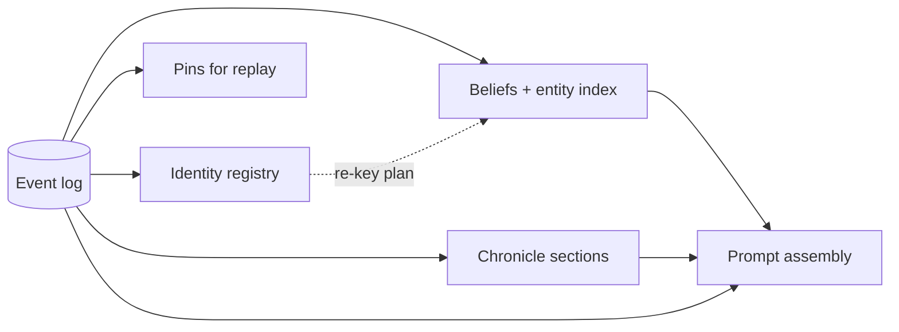
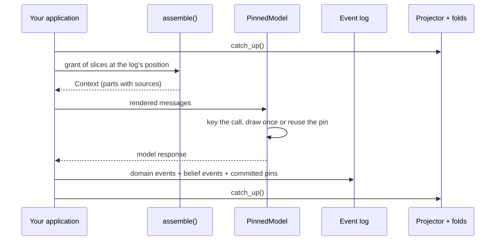

# How the Layers Fit Together

anagrapheus is built around one idea: a single append-only event log is the authoritative record of what happened, and everything else is derived from it. This page explains how the six subpackages hang off that log, how one agent turn moves through them, and where the library stops and your application starts.

## One log, many projections

Most agent frameworks keep state in several places at once: a message history, a memory store, a vector index, a cache of model responses. Each is written separately, so they drift apart, and none of them can tell you what the agent actually saw on turn 37.

anagrapheus keeps exactly one thing that is not derived: the **event log**, held by [`SQLiteEventStore`][sqlite-store] (or any store implementing the [`EventStore`][event-store] protocol). Every other component is a **projection**: state computed from the log by a **fold**, a function that applies the log's events one at a time, in order. A projection can be deleted and rebuilt by replaying the log, so it is never the only copy of anything. The [Event Log and Projections](event-log-and-projections.md) page covers these terms in detail.

Each box on the right is one subpackage's read model:

| Subpackage | What it projects from the log | Explained in |
|---|---|---|
| `anagrapheus.timeline` | The log itself, folds, positions, pins and replay | [The Event Log and Projections](event-log-and-projections.md), [Pinning and Replay](pinning-and-replay.md) |
| `anagrapheus.provider` | Nothing: it is the one layer that talks to a model, and it keeps no state of its own | [Pinning and Replay](pinning-and-replay.md) |
| `anagrapheus.identity` | Which entity each name refers to, from establish, alias, merge and split decisions | [Identity](identity.md) |
| `anagrapheus.beliefs` | What each holder believes, stored in doxastica, plus an index from entities to belief ids | [Beliefs](beliefs.md) |
| `anagrapheus.chronicle` | Prose summaries of closed ranges of the log | [The Chronicle](chronicle.md) |
| `anagrapheus.assembly` | Nothing persistent: it reads the others at one position to build a model's context | [Prompt Assembly](prompt-assembly.md) |

Because they all fold the same log, they can share one SQLite file. The SQLite stores for the identity registry, the entity index and the chronicle each take a connection; hand them the event store's own, and a projection's state and its record of how far it has read commit in the same transaction.

## Why the log has to be the authority

The design pays off in three places.

**Replay.** Every nondeterministic effect (a model response, a tool result, a freshly minted id) is recorded in the log under a key. Replaying a run means answering those effects from the log instead of performing them again, so a recorded run can be reproduced offline, in a test, with no model reached at all. If the code now asks something different, the replay fails at the first changed call instead of quietly drawing a new answer.

**Rebuild.** Because projections are disposable, changing how a projection is stored, or fixing a bug in a fold, means dropping the projection and replaying the log. There is no migration of derived data, because derived data is never the source of truth.

**Audit.** Every belief records the event it was folded from, every identity decision is an event with a position in the log, and every assembled prompt records which events, beliefs and sections it was built from. "Why does this agent believe that?" and "what was this call shown?" are questions the log can answer.

The cost is discipline: anything an agent should remember must reach the log as an event, and anything computed from the log must be computed deterministically, or the rebuild stops reproducing what the run saw. The chronicle is the one deliberate exception, with its own rules for rebuilding; see [The Chronicle](chronicle.md).

## How one turn flows through the layers

The negotiation example in `examples/negotiation/` runs the UK and the EU through rounds of a fisheries negotiation. One party's turn touches every layer:

1. The application brings its projections up to date, so beliefs and identity reflect everything appended so far.
2. It opens a **grant**, the set of read-only slices this role may read, at the log's current position, and calls [`assemble`][assemble]. The result is a [`Context`][context]: structured parts, each citing the events, beliefs or chronicle sections it was built from.
3. It renders the context into messages and sends them through an agent whose model is wrapped in [`PinnedModel`][pinned-model]. The wrapper derives a key from what the model is being asked, and either draws once or reuses the response already pinned under that key.
4. It appends what happened as events: the party's stated position, the beliefs the turn produced, and the unit of work's pins, promoted from the ledger's scratch area into the log when the ledger is committed.
5. The next catch-up folds those events into the identity registry, the belief store and, at the end of a round, the chronicle.

Under replay, step 3 answers from the log and the model is never called. Everything else runs exactly as it did live.

## What the library decides, and what you decide

anagrapheus ships the mechanism and leaves the meaning to the application. The library cannot know what your domain means by "the same question", "the same person" or "too long a prompt", and guessing would produce answers that look right while being wrong. So the split is deliberate, and it is the same in every layer.

| The library owns | Your application owns |
|---|---|
| Pin keys, the pin ledger, promotion of pins into the log, strict and record replay | The call policy: what counts as "the same call" ([`SemanticCallPolicy`][semantic-policy] is a working default) |
| Which tools are pinned once you wrap them | Which tools to wrap: a world-reading tool should be pinned, a deliberately live one (a clock, a current price) should not |
| Folds, positions, transactional position commits, rebuild | Event vocabularies: your domain events, and how you bind them to identity roles and belief interpreters |
| Minting belief ids from declared predicates, arity and vocabulary checks | The predicate vocabulary itself, and the list of scopes (holders) you model |
| Recording identity decisions; exact matching of names; the re-key plan after a merge or split | Identity judgments (whether two names are one entity) and applying the re-key plan to each scope |
| Consolidating closed units into sections that cite their range | The unit boundary, the summariser and its prompt |
| Grant and citation checks, register labelling, a budget pass that never sheds binding parts | Roles and their grants, slot names, rendering parts into messages, the token counter and the total |

!!! info "Why some loops are left to you"
    Applying a re-key plan is the clearest case. The library can compute what each affected belief id becomes, but it cannot know which scopes hold that belief (you decide how many minds you model) or which product of a split a belief belongs to (that depends on what the belief says). The negotiation example's `rekeying.py` shows the loop an application writes. See [Identity](identity.md#re-keying-is-planned-by-the-library-and-applied-by-you).

The library logs under the `anagrapheus` logger and never configures logging, so its records appear only once your application sets up a handler.

## When anagrapheus is not the right fit

The library earns its keep when runs are long, multi-agent and worth reproducing. It is probably more machinery than you need when:

- **Each call stands alone.** A single-shot classifier or summariser with no state between calls gains little from an event log. Response caching may be enough.
- **You need a chat transcript.** Prompt assembly builds a fresh context for each call from projections; it does not accumulate message history across turns. A tool loop inside one call is still pinned per request, but a long-running conversational memory is not something the library models.
- **You need ranked retrieval.** The chronicle exposes a retriever port with a deliberately naive substring default. Semantic search belongs to a retrieval library behind that port.
- **You cannot route state through events.** If agents mutate shared state that the log never sees, projections will not reflect it and replays will not reproduce it.

## Where to go next

- To see every layer working together, follow the [negotiation example tutorial](../tutorials/negotiation-example.md).
- To record and replay your own agent, start with [Getting Started](../tutorials/getting-started.md), then [How to Record a Run and Replay It Offline](../how-to/record-and-replay.md).
- For the foundations, read [The Event Log and Projections](event-log-and-projections.md) next.

[sqlite-store]: ../reference/anagrapheus/timeline/sqlite.md#anagrapheus.timeline.sqlite.SQLiteEventStore
[event-store]: ../reference/anagrapheus/timeline/store.md#anagrapheus.timeline.store.EventStore
[assemble]: ../reference/anagrapheus/assembly/assemble.md#anagrapheus.assembly.assemble.assemble
[pinned-model]: ../reference/anagrapheus/provider/model.md#anagrapheus.provider.model.PinnedModel
[semantic-policy]: ../reference/anagrapheus/provider/policy.md#anagrapheus.provider.policy.SemanticCallPolicy
[context]: ../reference/anagrapheus/assembly/parts.md#anagrapheus.assembly.parts.Context
