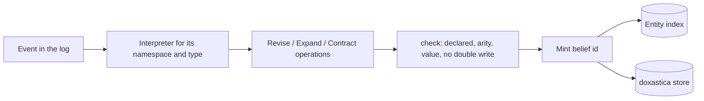

# Beliefs

In a multi-agent run each agent needs its own revisable view of the world, including views that are wrong. The UK can believe the EU will hold firm on fisheries while the EU has privately decided to concede. This page explains how anagrapheus models those beliefs, what the belief store is responsible for and what this library adds, and why the rules about belief ids are as strict as they are.

## The vocabulary

- A **scope** is whose beliefs these are: one per holder. In the negotiation the UK and the EU each have a scope. Beliefs in one scope never leak into another; two scopes can hold contradictory beliefs at the same time.
- A **proposition** is one question a holder can have a belief about: "what is the UK's red line on fisheries?".
- A **predicate** is the declared shape of a family of propositions: `red_line(party, clause)`. Applying a predicate to specific entities gives one proposition.
- A **belief id** is the string that names a proposition, minted from the predicate and the entities' ids.
- The **value** is the holder's answer to the question (`"hold_firm"`), and the **stance** is how firmly the holder holds it (`doubted`, `suspected`, `believed` or `certain`).

Beliefs change through three operations from AGM belief-revision theory:

- **revise**: come to hold a value, superseding whatever this scope held for the proposition. "The UK now believes the EU's red line is `concede`."
- **expand**: add a belief without enforcing consistency with what is already held.
- **contract**: stop holding the proposition at all. Retracting something not held does nothing.

## doxastica holds the beliefs; anagrapheus supplies the ids and the fold

The beliefs themselves live in [doxastica](https://pypi.org/project/doxastica/), a separate library that anagrapheus depends on. doxastica keeps per-scope revision chains, the dependency edges between beliefs, and what a retraction leaves stale. What it deliberately does not do is decide what a belief is *about*: its `belief_id` is any string the caller supplies.

That freedom is the integration problem anagrapheus solves. If two parts of an application spell the same question two different ways, they create two unrelated beliefs, and nothing notices. So this library adds three things around doxastica:

1. **A predicate registry** that is the only way to mint a belief id.
2. **A fold** that applies belief-changing events from the log to the doxastica store, in order, so the store is a **projection**: derived state that can be dropped and rebuilt from the log, like every other read model (see [The Event Log and Projections](event-log-and-projections.md)).
3. **An index from entities to belief ids**, written by the same fold, so that "which beliefs mention this entity?" has an answer when identity merges two entities.

## The id names the question; the value answers it

The rule behind every belief id is short: if two states cannot both be true at once, they share an id; if they can, they must not.

Consider "who does the UK trust?". Modelled as `trusts(uk)` with the trusted party in the value, revising the belief to `"france"` would silently retract the earlier belief that the UK trusts the EU. Nobody asked for that retraction and nothing records it. Modelled as `trusts(uk, eu)` with a value of `True`, each relationship is its own proposition, and believing the UK trusts France says nothing about the EU.

anagrapheus turns that advice into checks a [`Predicate`][predicate] enforces mechanically:

- **Arity.** Each predicate declares how many entities it takes, and minting at any other arity raises [`WrongArity`][wrong-arity]. A predicate declared as `trusts/2` cannot be minted as `trusts(uk)`, so the silent-retraction shape is unreachable.
- **Kind.** A [`PredicateKind`][predicate-kind] of `FUNCTIONAL` holds one value at a time, so revision correctly replaces the old answer: the UK's red line moves from `hold_firm` to `concede`. A `RELATIONAL` predicate's value only asserts that the proposition holds, so it must be a bool.
- **Vocabulary.** A functional predicate may declare `values`, the words its answer can be. Any other word raises [`OutsideVocabulary`][outside-vocabulary]. Without this, a live model writing `hold firm` beside a domain's `hold_firm` produces two answers no comparison can match. Vocabulary is optional because many answers cannot be listed (a location, a name), and it is not part of the id, so widening it later does not orphan existing beliefs.
- **Order.** A predicate with `ordered=False` treats its arguments as interchangeable: `allied(uk, eu)` and `allied(eu, uk)` mint the same id.

```python title="belief_ids.py"
import uuid

from anagrapheus.beliefs import (
    OutsideVocabulary,
    Predicate,
    PredicateKind,
    PredicateRegistry,
    WrongArity,
)

uk, eu, fisheries = uuid.uuid7(), uuid.uuid7(), uuid.uuid7()
predicates = PredicateRegistry(
    [
        Predicate(
            "red_line",
            arity=2,  # (party, clause)
            kind=PredicateKind.FUNCTIONAL,
            values=frozenset({"hold_firm", "concede", "walk_away"}),
        ),
        Predicate("trusts", arity=2, kind=PredicateKind.RELATIONAL),
    ],
    namespace="negotiation",
)

# The id names the question: "what is the UK's red line on fisheries?"
print(predicates.belief_id("red_line", uk, fisheries))
# A relational predicate puts every party in the id; its value is only True/False.
print(predicates.belief_id("trusts", uk, eu))

try:
    predicates.belief_id("trusts", uk)  # "the UK trusts <value>" cannot be minted
except WrongArity as error:
    print(error)

try:
    predicates.predicate("red_line").check_value("hold firm")  # not a declared word
except OutsideVocabulary as error:
    print(error)
```

```text
v1:negotiation:red_line(01a13299-50ce-77cb-88d3-7ca531fab288,01a13299-50ce-77cb-88d3-7ca73ba05df7)
v1:negotiation:trusts(01a13299-50ce-77cb-88d3-7ca531fab288,01a13299-50ce-77cb-88d3-7ca6b50803e3)
predicate 'trusts' takes 2 entities, got 1
predicate 'red_line' answers with one of ['concede', 'hold_firm', 'walk_away'], not 'hold firm'
```

### Why ids are legible rather than hashed

A belief id reads `v1:<namespace>:<predicate>(<entity ids>)`. A digest would be shorter, but a legible id can be taken apart again with [`PredicateRegistry.parse`][registry-parse]. That matters when two entities merge: re-keying a belief means substituting one entity id for another and minting again, which is a pure function of a legible id. With a digest, only the index would know what each belief was about, and the index would stop being a disposable projection.

The other parts of the id each guard against a specific failure:

- **`v1`** is the minting scheme. If the rule for building ids ever changes, the scheme number changes too, and an id is always re-minted under the scheme that produced it. An unknown scheme raises rather than being silently re-minted under today's rule.
- **The namespace** is a required argument to [`PredicateRegistry`][predicate-registry], with no default. doxastica keys revision history on the belief id alone, across scopes. Between two holders in one simulation that shared key is exactly what lets their beliefs be compared. Between two tenants it would be a leak. The library cannot guess which you are building, so it makes you say.
- **Entities are ids, never prose.** If a model produced the claim, have it produce a predicate and entity ids rather than a sentence for something to parse.

### Minting a belief id is derivation, not a draw

A belief id is computed from a predicate and entity ids that already exist, so it consumes no randomness. It needs no pin, and minting the same proposition twice is harmless. This is the opposite of minting an *entity* id, which draws a fresh UUID and does need pinning; see [Identity](identity.md#minting-an-entity-id-is-a-draw). The two sit one layer apart and are easy to confuse.

## Beliefs are a fold over the log

Nothing writes to the belief store directly. A change in belief reaches the log as an event, and [`BeliefFold`][belief-fold] folds it into doxastica.



An **interpreter** is a pure function from an event to the belief operations it implies ([`Revise`][revise], [`Expand`][expand], [`Contract`][contract]), registered for one `(namespace, type)`. Operations name a belief by predicate and entities, never by id, so the fold always mints through its own registry and an interpreter cannot mint around it. For each operation the fold mints the id, records it in the entity index, and writes doxastica, so the index and the store can never disagree about what was minted.

There are two ways for beliefs to reach the log:

- **The library's own events.** [`BeliefRevised`][belief-revised], [`BeliefExpanded`][belief-expanded] and [`BeliefContracted`][belief-contracted] are for beliefs no domain event already carries: a seeded goal, a conclusion a model wrote, a re-key. [`BeliefEvents`][belief-events] builds them, runs the checks, and returns a [`PendingEvent`][pending-event] for you to append. It writes nothing itself, so a belief changes in the same batch as whatever caused it.
- **Your own events.** If an event in your domain already *is* the belief (the EU overheard the UK's side remark, so the EU now believes the UK would concede), bind its type to an interpreter and pass it to `BeliefFold(..., interpret={...})`. The fold then derives the belief from your event, and no library event is appended beside it.

!!! warning "An interpreter must be pure, so resolve names before the event is written"
    The fold runs interpreters again on every rebuild, possibly long after the event was written. An interpreter that consults something that moves, such as the identity registry's merge chain, would make a rebuilt store differ from the incremental one. Resolve names to entities, and choose among candidates, when you build the event, and carry the answers in its payload.

### Checks run before append

Once an event is in the log, it is permanent. If the fold refused an operation, it would refuse it again on every replay, and the projection would be stuck on that event. So the checks belong before append: [`check(predicates, ops)`][check] verifies that each predicate is declared, the arity is right, the value is one the predicate can hold, and no proposition is written twice in one scope by one event. `BeliefEvents` calls it on every event it builds. For your own events, call it on what your interpreter returns before appending ([`BeliefEvents.check(*ops)`][belief-events-check] does the same). The fold runs the same check again and raises, so a bad event that got past is loud rather than a belief silently missing.

### Source and cause are different questions

Every belief state records a `source_event_id`, and in anagrapheus that is always the event it was folded from. That keeps doxastica's as-of order identical to the log's order, and it is what lets the fold recognise its own writes. *Why* the scope came to believe it, such as the observation that prompted a model's conclusion, is the belief event's `causation_id`, the same envelope field every other layer uses.

### Surviving a crash

The projector commits the belief fold's position inside the log's transaction, but doxastica is outside that transaction. A crash between the two re-applies the last batch on restart, and doxastica's `revise` is not idempotent. The fold handles this exactly: before writing, it looks for a state in this scope, for this belief, sourced from this event. If one exists, the operation already ran, so the state is reused and only its edges are laid again (laying an edge twice is harmless). This works because of the rule above that one event writes one proposition in one scope at most once.

### Edges between beliefs

A belief can rest on another: a conclusion derived from an observation. Retract the observation and doxastica reports the conclusion as impacted. An edge in an event names its target with a [`StateRef`][state-ref], the triple of scope, belief id and source event, because doxastica's own state ids are freshly minted on every fold and could never be replayed. A reference that resolves to nothing raises [`UnresolvedStateRef`][unresolved-state-ref], and the operation is refused whole rather than written without its dependency.

### Rebuilding the belief store

doxastica has no "clear" operation, so [`BeliefFold.reset(store)`][belief-fold-reset] takes a new, empty store to fold into and empties the entity index beside it. Readers then find the current store at [`BeliefFold.store`][belief-fold-store]. You own that swap, because only you know what kind of store it is.

!!! danger "An in-memory belief store is empty on reopen, but its position is not"
    The belief fold's **position**, the `seq` of the last event it folded, is persisted in the event store. If the doxastica store is in memory, reopening the database gives you a position saying everything has been folded and a store holding nothing. Rebuild the belief fold on open whenever its position is above zero; the negotiation example's table does exactly this.

## The entity index

The index answers one question neither library can: which belief ids mention this entity? doxastica can filter *by* a belief id but never looks inside one, and the identity layer knows entities but has never heard of a belief. [`BeliefIndex.beliefs_for(entity_id)`][beliefs-for] is the join, and it is what makes re-keying after a merge executable; see [Identity](identity.md#re-keying-is-planned-by-the-library-and-applied-by-you).

The index records what was *minted*, not what is currently believed. A row says an id exists; whether any scope holds a belief under it is a question for doxastica. And because ids are minted the same way in every scope, the index is scope-free: it can say a belief id needs re-keying, but not which scopes hold it.

## Measuring disagreement

[`divergence(store, holder, reference)`][divergence] lists the beliefs `holder` holds with a different value from `reference`. If the UK's scope holds `red_line(eu, fisheries)` as `hold_firm` and the EU's own scope holds it as `concede`, then `divergence(store, "uk", "eu")` reports that belief id with both values: the UK has misread the EU.

Two details make it trustworthy:

- **Only propositions both scopes hold are compared.** A belief one scope holds and the other has never had is an absence, not a disagreement; treating the two alike would report every gap in a holder's knowledge as a contradiction.
- **It relies on shared minting.** The comparison is by belief id, so it works only because both scopes minted their ids through the same registry. That is the practical payoff of making the registry the only way to mint.

Whether a disagreement *matters* is your reading of your own values; to the library, values are opaque.

## What the library decides, and what you decide

| The library | Your application |
|---|---|
| Minting ids, and the arity, kind and vocabulary checks | The predicate vocabulary: names, arities, kinds, value words |
| The fold, its idempotence, the entity index | Which scopes exist (the library cannot enumerate them) |
| Refusing an event the fold could not apply | Interpreters for your own events, and resolving names before writing |
| `divergence` between two scopes | What a disagreement means |
| Planning re-keys from identity decisions | Applying the plan in each scope |

For the procedure, see [How to Keep Per-Agent Beliefs as a Fold](../how-to/per-agent-beliefs.md).

[predicate]: ../reference/anagrapheus/beliefs/predicates.md#anagrapheus.beliefs.predicates.Predicate
[predicate-kind]: ../reference/anagrapheus/beliefs/predicates.md#anagrapheus.beliefs.predicates.PredicateKind
[predicate-registry]: ../reference/anagrapheus/beliefs/predicates.md#anagrapheus.beliefs.predicates.PredicateRegistry
[registry-parse]: ../reference/anagrapheus/beliefs/predicates.md#anagrapheus.beliefs.predicates.PredicateRegistry.parse
[belief-fold]: ../reference/anagrapheus/beliefs/fold.md#anagrapheus.beliefs.fold.BeliefFold
[belief-fold-reset]: ../reference/anagrapheus/beliefs/fold.md#anagrapheus.beliefs.fold.BeliefFold.reset
[check]: ../reference/anagrapheus/beliefs/fold.md#anagrapheus.beliefs.fold.check
[revise]: ../reference/anagrapheus/beliefs/ops.md#anagrapheus.beliefs.ops.Revise
[expand]: ../reference/anagrapheus/beliefs/ops.md#anagrapheus.beliefs.ops.Expand
[contract]: ../reference/anagrapheus/beliefs/ops.md#anagrapheus.beliefs.ops.Contract
[state-ref]: ../reference/anagrapheus/beliefs/ops.md#anagrapheus.beliefs.ops.StateRef
[belief-events]: ../reference/anagrapheus/beliefs/writer.md#anagrapheus.beliefs.writer.BeliefEvents
[beliefs-for]: ../reference/anagrapheus/beliefs/index-module.md#anagrapheus.beliefs.index.BeliefIndex.beliefs_for
[divergence]: ../reference/anagrapheus/beliefs/divergence.md#anagrapheus.beliefs.divergence.divergence
[wrong-arity]: ../reference/anagrapheus/beliefs/errors.md#anagrapheus.beliefs.errors.WrongArity
[outside-vocabulary]: ../reference/anagrapheus/beliefs/errors.md#anagrapheus.beliefs.errors.OutsideVocabulary
[belief-revised]: ../reference/anagrapheus/beliefs/events.md#anagrapheus.beliefs.events.BeliefRevised
[belief-expanded]: ../reference/anagrapheus/beliefs/events.md#anagrapheus.beliefs.events.BeliefExpanded
[belief-contracted]: ../reference/anagrapheus/beliefs/events.md#anagrapheus.beliefs.events.BeliefContracted
[pending-event]: ../reference/anagrapheus/timeline/envelope.md#anagrapheus.timeline.envelope.PendingEvent
[belief-events-check]: ../reference/anagrapheus/beliefs/writer.md#anagrapheus.beliefs.writer.BeliefEvents.check
[unresolved-state-ref]: ../reference/anagrapheus/beliefs/errors.md#anagrapheus.beliefs.errors.UnresolvedStateRef
[belief-fold-store]: ../reference/anagrapheus/beliefs/fold.md#anagrapheus.beliefs.fold.BeliefFold.store
