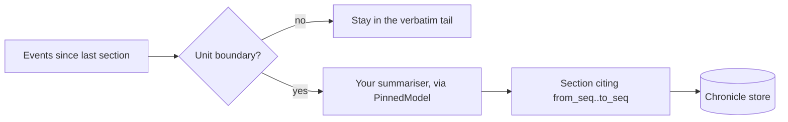

# The Chronicle

A long run eventually has more history than fits in a model's context. The chronicle is anagrapheus's answer: it consolidates closed stretches of the log into prose sections, each citing exactly which events it covers, while recent events stay verbatim. This page explains what that buys, why the chronicle is the one projection whose content a model writes, and the rules that follow from that.

## Compaction that destroys nothing

Most context-compaction schemes summarise the old messages and throw them away. If the summary is wrong, the original is gone. The chronicle never deletes anything, because the log it summarises is still there:

- **Sections cite the range they cover.** Each [`Section`][section] has an [`Anchor`][anchor] giving the inclusive `from_seq` to `to_seq` range of the log it consolidates. Any claim in the prose can be checked against the events it came from.
- **Sections supersede; they are never corrected.** The chronicle store has no update and no delete. A re-consolidation of a range writes a new section that names the one it supersedes, and the old prose stays readable by id, so you can still see what a past run actually read.
- **Recency and depth are separate.** The most recent events are read straight from the log, verbatim; only older, closed units are read as prose. This split is **recency versus depth**.
- **Retrieval returns sections, not raw chunks.** The [`Retriever`][retriever] port hands back distilled, ranked sections rather than fragments of events.

Sections are rows in a **projection**'s own table (state derived from the log by a fold, as described in [The Event Log and Projections](event-log-and-projections.md)), not events in the log. A section is derived from the log after the fact; putting it into the log would make the authoritative record contain its own derivation. Pins are in the log because they record randomness a run consumed. Sections are a read model, which is a different kind of thing.

## When consolidation happens

The application decides what a unit of work is: a turn, a round, a scene, a session. You supply a **unit boundary**, an object implementing [`UnitBoundary`][unit-boundary] that says whether a given event closes a unit. [`EventTypes`][event-types] is the simple case, naming the marker event types outright; the negotiation example uses its `RoundClosed` event.

When [`ChronicleFold`][chronicle-fold] sees a boundary, it reads every event since the last consolidated range and hands them to your **summariser**, an object implementing [`Summarizer`][summarizer], which returns a [`Consolidation`][consolidation]: the prose and the pin keys its model calls used. The fold writes that as a new section covering the range.

## The first generative projection

Every other projection in anagrapheus is **deterministic**: fold the same log, get the same state. The chronicle cannot be, because a model writes its prose. Fold the same log again against a fresh model and you get different words. So `ChronicleFold` declares itself `"generative"`, and the guarantee it offers is narrower and precise:

**Same log, same anchors; the prose is regenerated.**

Everything the fold derives from the log alone (which sections exist, the range each covers, where the boundaries fall, the order) is a pure function of the log and replays exactly. Section ids are derived from the range they cover (`"12-31"` for events 12 to 31) rather than drawn from a counter or a clock, so a rebuild produces identical anchors. The prose is identical only where the summariser's pinned model calls still hit; otherwise it is new text over the same range. Nothing claims that two consolidations are equivalent, because nothing could check it.

### The summariser builds the key

A generative fold's model calls should be pinned like any other. The obvious place to build their key would be the fold, from the range it is consolidating. That key would be blind to the one thing most likely to change: the summariser's prompt. Edit the prompt, and a fold-built key would still serve the old consolidation.

So the fold builds no key. The summariser does, by drawing through [`PinnedModel`][pinned-model], which keys the whole request, prompt included. A changed prompt is a different key, and therefore a miss. `PinnedModel`'s `on_key` callback hands the summariser the keys it used, which it returns in `Consolidation.pins` so that each section records the pins it was built from. A rebuild through replay can then be shown to be bit-exact rather than assumed to be.

!!! warning "A consolidation prompt must not contain identifiers"
    If the summariser's prompt renders entity ids, belief ids or event ids, it differs on every run against a fresh store, so every pin misses and every consolidation is drawn again. Render events by their human-readable fields instead.

### Draws happen outside the write lock

The projector normally applies a batch inside one database transaction, so a projection's state and its position commit together. A model call inside that transaction would hold SQLite's write lock for as long as the model takes to answer, blocking every append in the process. So the chronicle does its drawing in `prepare(event)`, which the projector calls for every event in a batch before it opens the transaction, and `apply` only writes what was prepared. Consolidation is background work; it must never stall the turn that is happening now.

The draw is also the one part that may be awaited. An async application cannot make a blocking model call from inside its event loop, and it cannot move the projector to a worker thread either, because a SQLite connection belongs to the thread that opened it. So the summariser may be a coroutine, and [`Projector.catch_up_async()`][projector-catch-up-async] awaits each draw with no transaction open, then writes the batch and its position synchronously on the loop's own thread. Only the slow part waits on the network; the store never leaves the thread that opened it. [Consolidate from async code](../how-to/chronicle-sections.md#consolidate-from-async-code) shows it.

If `apply` fails part-way through a batch, the draws it has already used are lost with the batch, so the next `catch_up()` makes those model calls again: that costs money, but the anchors come out the same.

That also means the chronicle should run on its own [`Projector`][projector], driven on its own schedule, separate from the projector that keeps beliefs and identity current before each turn.

## Two read surfaces at two grades

Generated prose is useful context for a model's next step. It must not settle anything: a validator's verdict, a gate, what counts as having happened. The rule is easy to state and easy to forget under deadline, so it is built into the API as two separate objects, neither reachable from the other:

- [`Anchors`][anchors] is the deterministic surface: ranges, boundaries, supersession and [`consolidated_through()`][consolidated-through], where the consolidated past ends. Safe for decisions, because a rebuild reproduces all of it.
- [`Prose`][prose] is the generated surface: the words. Advisory only.

A caller that needs to decide something takes `Anchors` and finds there is no prose on it to misuse.

[`Brief`][brief] combines the two halves of the recency/depth split for reading: [`tail(since_seq=...)`][brief-tail] returns the log's own events verbatim as [`Recent`][recent], and [`depth()`][brief-depth] returns the consolidated sections. The tail is read from the log, never from the chronicle, so near-term continuity never depends on generated prose. It also makes consolidation lag invisible: if the chronicle is behind, the tail simply covers more.

!!! warning "A shared chronicle can only carry public content"
    One chronicle is read by every role it is shown to. If its prose summarises a private event, such as a side remark only one party overheard, that event reaches every reader's prompt, including the party who believes it went unheard. There is no wording of a shared summary that describes a private event correctly for every reader. Keep private events out of what the summariser is given; [Prompt Assembly](prompt-assembly.md) shows how a slice's `admit` filter does that.

## Why rebuilding needs acknowledgement

For a deterministic projection, rebuilding is free: drop it, replay, get the identical thing back. For the chronicle it is neither cheap nor exact. Rebuilding re-runs every model call the chronicle ever made, which is the whole cost again, and returns the same anchors with different prose. Anything that read the old prose read something that no longer exists.

So [`Projector.rebuild`][projector-rebuild] refuses a generative fold, raising [`GenerativeRebuild`][generative-rebuild], unless you pass `discard_generated=True` to say out loud that you accept both costs. The one exception to "different prose" is a rebuild whose summariser draws through a [replay resolver](pinning-and-replay.md) built from the log: consolidations whose pins were committed then come back word for word, with the model never reached.

### Carry it instead

Because rebuilding is lossy, the chronicle is the one projection better **carried** across a change of storage backend than rebuilt. [`SQLiteChronicleStore`][sqlite-chronicle] (any [`ChronicleStore`][chronicle-store]) offers [`export()`][store-export], every row including superseded ones, and [`load(sections)`][store-load], which inserts them and skips ids already present. `load` is idempotent, so an interrupted carry can simply be repeated.

`load` is not a merge. Section ids come from the ranges they cover, which is what makes anchors replay, so two chronicles over the same log collide on every id, and the incoming prose is dropped in favour of what is already there.

Carrying grants no authority. A carried chronicle and a rebuilt one are equally valid, because neither is the record of what happened: the log is.

!!! info "Deliberate re-consolidation sits outside the replay guarantee"
    Re-consolidating a range by hand, say with a better prompt, writes a section that supersedes the old one. Nothing in the log records that you did it, so it is not something a fold can derive: a rebuild discards it and returns the original generation. That is one more reason to carry a chronicle rather than rebuild it. It also means re-consolidation changes what later prompts are shown, so runs that read the old prose will no longer replay against the new one.

## Retrieval stays behind a port

Ranked retrieval over sections is a well-served problem with its own libraries, so the chronicle exposes a `Retriever` port rather than implementing one. The bundled [`substring_retriever`][substring-retriever] is case-insensitive substring matching, most recent first, and is named for what it is so that nobody mistakes it for ranked search. Replace it with your own.

## What the library decides, and what you decide

| The library | Your application |
|---|---|
| Watching for boundaries and reading each closed range | What closes a unit |
| Range-derived section ids and anchor replay | The summariser, its prompt and its model |
| Drawing outside the write transaction | Which projector runs the chronicle, and when |
| Separate `Anchors` and `Prose` surfaces; the tail from the log | Not letting prose settle anything once you have read it |
| Refusing an unacknowledged rebuild; `export` and `load` | Whether to carry or rebuild; ranked retrieval |

For the procedure, see [How to Consolidate History into Chronicle Sections](../how-to/chronicle-sections.md).

[section]: ../reference/anagrapheus/chronicle/sections.md#anagrapheus.chronicle.sections.Section
[anchor]: ../reference/anagrapheus/chronicle/sections.md#anagrapheus.chronicle.sections.Anchor
[retriever]: ../reference/anagrapheus/chronicle/reading.md#anagrapheus.chronicle.reading.Retriever
[unit-boundary]: ../reference/anagrapheus/chronicle/fold.md#anagrapheus.chronicle.fold.UnitBoundary
[event-types]: ../reference/anagrapheus/chronicle/fold.md#anagrapheus.chronicle.fold.EventTypes
[chronicle-fold]: ../reference/anagrapheus/chronicle/fold.md#anagrapheus.chronicle.fold.ChronicleFold
[summarizer]: ../reference/anagrapheus/chronicle/fold.md#anagrapheus.chronicle.fold.Summarizer
[consolidation]: ../reference/anagrapheus/chronicle/fold.md#anagrapheus.chronicle.fold.Consolidation
[pinned-model]: ../reference/anagrapheus/provider/model.md#anagrapheus.provider.model.PinnedModel
[projector-catch-up-async]: ../reference/anagrapheus/timeline/folds.md#anagrapheus.timeline.folds.Projector.catch_up_async
[projector]: ../reference/anagrapheus/timeline/folds.md#anagrapheus.timeline.folds.Projector
[anchors]: ../reference/anagrapheus/chronicle/reading.md#anagrapheus.chronicle.reading.Anchors
[prose]: ../reference/anagrapheus/chronicle/reading.md#anagrapheus.chronicle.reading.Prose
[brief]: ../reference/anagrapheus/chronicle/reading.md#anagrapheus.chronicle.reading.Brief
[recent]: ../reference/anagrapheus/chronicle/reading.md#anagrapheus.chronicle.reading.Recent
[sqlite-chronicle]: ../reference/anagrapheus/chronicle/sqlite.md#anagrapheus.chronicle.sqlite.SQLiteChronicleStore
[chronicle-store]: ../reference/anagrapheus/chronicle/store.md#anagrapheus.chronicle.store.ChronicleStore
[consolidated-through]: ../reference/anagrapheus/chronicle/reading.md#anagrapheus.chronicle.reading.Anchors.consolidated_through
[brief-tail]: ../reference/anagrapheus/chronicle/reading.md#anagrapheus.chronicle.reading.Brief.tail
[brief-depth]: ../reference/anagrapheus/chronicle/reading.md#anagrapheus.chronicle.reading.Brief.depth
[projector-rebuild]: ../reference/anagrapheus/timeline/folds.md#anagrapheus.timeline.folds.Projector.rebuild
[generative-rebuild]: ../reference/anagrapheus/timeline/folds.md#anagrapheus.timeline.folds.GenerativeRebuild
[store-export]: ../reference/anagrapheus/chronicle/store.md#anagrapheus.chronicle.store.ChronicleStore.export
[store-load]: ../reference/anagrapheus/chronicle/store.md#anagrapheus.chronicle.store.ChronicleStore.load
[substring-retriever]: ../reference/anagrapheus/chronicle/reading.md#anagrapheus.chronicle.reading.substring_retriever
