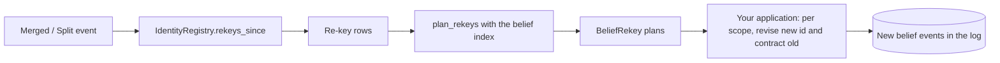

# Identity

Beliefs and pins both refer to things by id, so those ids have to be stable. The identity layer is where stable ids come from, and where the decision that two names refer to one thing is recorded. This page explains the two ways an entity comes into existence, why identity decisions are events rather than table edits, and how a merge turns into work for the belief layer.

## Establish or resolve

An entity reaches the identity layer by one of two paths, and which one applies depends on whether your system has naming authority.

- **Establish.** The system declares an entity into existence and mints its id. Nothing outside the system decides what it is, so there is nothing to match against. The negotiating parties, a round, a clause on the table, a hypothesis an agent forms: most of what a long-running agent reasons about is established.
- **Resolve.** The entity already exists in the world, and the system has to discover whether two names refer to it. Is *UK*, as one briefing calls it, the same party as *United Kingdom* in another? The world has already decided; the agent is guessing.

For resolved entities, the guesses are what need governing. Each judgment that two names are one entity, or that one name was covering two, is recorded as an event, and the registry that answers "which entity is this?" is a **fold** over those events: state built by applying them in log order (see [The Event Log and Projections](event-log-and-projections.md)). It can be rebuilt, audited and corrected like any other projection.

What this buys is governance, not inference. Something still has to judge that two names are one party, whether that is a rule in your code, a model call, or a person, and nothing in this layer makes that judgment for you.

!!! info "Nothing enforces which path you use"
    The layer records establish and resolve decisions alike but cannot check that an entity you established was really yours to name. If the distinction matters to your domain, record it in the `provenance` string you pass when establishing; the library stores it and never interprets it.

## Decisions are events

The five identity decisions are events with library-supplied shapes in `anagrapheus.identity`:

| Decision | Event | What it records |
|---|---|---|
| establish | [`Established`][established] | A new entity id and the first name it is known by |
| alias | [`Aliased`][aliased] | Another name for an existing entity |
| merge | [`Merged`][merged] | Two ids turned out to name one thing; `absorbed` yields to `kept` |
| split | [`Split`][split-event] | One id was covering several things; the names it assigns move to new entities |
| unmerge | [`Unmerged`][unmerged] | A merge was wrong; `absorbed` stops yielding to `kept` and takes its names back |

The history row for an establish records only the first name, not its stance; the stance is on the name itself, which [`surface_forms`][surface-forms] returns.

The helpers [`establish`][establish], [`alias`][alias], [`merge`][merge], [`split`][split] and [`unmerge`][unmerge] each return a [`PendingEvent`][pending-event] rather than appending one. An identity decision almost always accompanies the domain event that prompted it, so the decision goes into your batch and your transaction. [`IdentityFold`][identity-fold] folds the decisions into an identity store, and [`IdentityRegistry`][identity-registry] answers questions from it.

If your application already has its own event for one of these decisions (say an `EntityEstablished` in your own namespace), an [`IdentityVocabulary`][identity-vocabulary] binds each role to your event type and an adapter, so the fold reads your events and you never emit the library's. The default vocabulary binds the library's own events. The unmerge role is optional: a vocabulary that does not bind it still works, and simply cannot withdraw a merge.

### Correcting a decision appends, never edits

A mistaken decision is not deleted. Nothing in the log is ever rewritten, so a correction is a later event. A merge that should not have happened is withdrawn by an unmerge: the absorbed entity is canonical again under its own id, and takes back the names the merge moved onto the survivor. The merge stays in the log, and the history shows both decisions in order.

A split is a different correction. It says one id was covering several things, and mints new ids for them; use it when an entity was never one thing, and an unmerge when two entities should never have been joined.

This matters for audit: [`IdentityRegistry.history(entity_id)`][history] returns every decision that touched an entity, each anchored to its position in the log, so you can always see when and why two names came to be treated as one.

## Resolving a name returns candidates, not an answer

[`IdentityRegistry.resolve(name)`][resolve] returns a [`Resolution`][resolution]: the name and every entity it is attached to, never a bare id. Returning a single id would make a lookup look like a decision. When you have already established that a name is unambiguous, [`Resolution.sole()`][resolution-sole] returns the one candidate, and raises [`AmbiguousSurfaceForm`][ambiguous-surface-form] rather than picking one if there are several.

Matching is **exact**, after Unicode NFC normalisation. NFC is a claim about representation: two encodings of the same character are the same character. Case folding, collapsing whitespace or stripping accents are claims about meaning (is *uk* the same name as *UK*?), and the layer does not make them. If your domain wants them, normalise names before they reach the registry.

Candidates whose entities have since merged collapse into one, following each entity's merge chain to the id that survives ([`canonical`][canonical]).

### Stance, and ranking by it

Each name attached to an entity carries a **stance**: a token from your own vocabulary saying how firmly the name is held. The library stores it and never interprets it, for the same reason it never interprets `provenance`: what `"suspected"` means is your domain's business.

If you want candidates ranked, declare a [`Ladder`][ladder], your stance tokens ordered weakest first, and pass it to the registry. Candidates then come back strongest first. Without a ladder they come back in log order, because the layer has no opinion about which of two tokens is stronger. A ladder is a list of tokens rather than a numeric scale on purpose: a number invites arithmetic nobody has defined, and inserting a rung between two integers would silently re-grade every stored row. A token the ladder does not declare, including the default `UNGRADED`, ranks below every rung rather than raising, because the log may legitimately contain tokens this process has never seen.

## Minting an entity id is a draw

Establishing an entity mints a fresh UUID, which consumes randomness just as a model call does. Under replay, an unpinned mint draws a *different* id, and every belief, pin and reference keyed on the original id is silently orphaned.

[`mint_entity_id(material, resolver=...)`][mint-entity-id] draws the id through the [pin ledger](pinning-and-replay.md#the-life-of-a-pin), so a replayed run re-establishes the same entity. `establish(..., resolver=...)` does this for you. Without a resolver the id is a plain UUIDv7, which is correct for a run that will never be replayed and quietly wrong for one that will.

!!! warning "With a resolver, the mint material decides what counts as the same entity"
    The pin key for a mint is built from `material`, which defaults to the name and the provenance. Two genuinely different records that share both would be minted as one entity, erasing exactly the ambiguity this layer exists to preserve. Where that can happen, pass `material` with a discriminator that identifies the record, such as the source system's own id. It must be stable across runs: a counter or a timestamp would replay to a different entity.

## Merge and split

A **merge** says two ids name one referent. In the projection, the absorbed entity points at the survivor, and its names move to the survivor so that resolving or splitting the survivor can reach them. Where both entities held the same name, the survivor's own record wins. The log is untouched, and `history()` still shows which entity originally recorded each name.

An entity yields to one survivor at a time, and only an entity that has not yielded can be a survivor. To move an absorbed entity to a different survivor, unmerge it first and then merge it again. To merge into an entity that has itself been absorbed, merge into the entity it resolves to instead. Pass the registry to `merge(..., identity=registry)` and it raises [`AlreadyMerged`][already-merged] when either entity is already merged: `absorbed`, into `kept` or anywhere else, or `kept`, into anything.

A merge that reaches the log anyway changes nothing if `absorbed` is already merged, if `kept` is already merged, or if either entity was never established (the merge comes before its `establish` event, or there is none). The merge is recorded as ignored in the history of each entity it names that exists, and it emits no re-key rows, so the planner moves no beliefs for it. A later unmerge of the pair is ignored in turn. The check reads the registry, so it cannot see a merge earlier in the same batch that has not been appended yet; the fold still ignores the merge, so nothing is lost. The check does not refuse an entity it has not seen established, because one established earlier in the same batch is not in the registry yet. A projection folded by an earlier version of the library that already holds such a merge keeps the state it had until you rebuild it: for a double merge, the entity points at the second survivor.

A merge cycle (A into B, then B into A) would be a contradiction. Pass the registry to `merge(..., identity=registry)` and it raises [`MergeCycle`][merge-cycle] before the event exists. A cycle that reaches the log anyway is never folded: its last merge names a survivor that has already yielded, so the fold ignores it. Only a projection folded by an earlier version of the library can still hold a cycle. Reading the canonical id there raises `MergeCycle` rather than looping, and unmerging one of its merges, or rebuilding, repairs it.

An **unmerge** withdraws one merge: the direct merge of `absorbed` into `kept`. In the projection, `absorbed` stops pointing at `kept` and takes back the names the merge moved off it, including the names of anything that was merged into `absorbed` before. If `kept` has since been merged into another entity, that merge carried the names on with it, and the unmerge takes them back from there. Some names stay where they are: a name `kept` recorded for itself (before the merge or since) stays on `kept` as well, as does a name that another merge into `kept`, still standing, also brought; and a name a later split moved to a new entity stays on that entity. The unmerge follows the very names the merge moved, not every name spelled the same way: if `kept`, or an entity it was later merged into, records the same name again, that is a name of its own and stays where it is. The outcome is what each entity would hold had the withdrawn merge never happened, except for what a split has taken since. Where several entities' records of one name end up on the same entity, it shows its own latest record of the name, and otherwise the one brought by the earliest merge. [`unmerge(types, registry, kept=..., absorbed=...)`][unmerge] checks the registry before it builds the event, and raises [`NotMerged`][not-merged] if `absorbed` is not merged directly into `kept`. An unmerge that matches no merge when it is folded (one built by hand, say) changes nothing and is recorded in both entities' history as ignored; the fold does not raise, because the event is already in the log. A projection folded by an earlier version of the library did not record which merges carried each name, so an unmerge of a merge it already holds gives no names back until you rebuild it.

A **split** says one id was covering several referents. Each assignment in the split creates a new entity and lists the names that move to it; names not listed stay with the original, which survives. Nothing yields to anything in a split, so the original's canonical id is unchanged.

## Re-keying is planned by the library and applied by you

A merge has consequences beyond identity. Every belief minted on the absorbed entity, such as `red_line(<United Kingdom>, fisheries)`, is now keyed on an id that names nothing, and needs to move to the survivor. That is a **re-key**: rewriting a belief under a new belief id with one entity substituted for another.

The work crosses three hands:

1. **Identity states the consequence.** [`IdentityRegistry.rekeys_since(seq)`][rekeys-since] returns a row for each decision above a position: one row for a merge, naming its target, and one row *per new entity* for a split. An unmerge has a split's shape: two rows from where the survivor stands, one naming that entity and one the entity it gave back, because a belief keyed on the survivor may have been about either. If the survivor has since been merged on, its beliefs went with it, so the rows come from the entity it resolves to now. The identity layer does not know what a belief is, so it does no more than that.
2. **The belief layer plans.** [`plan_rekeys(rows, index, predicates)`][plan-rekeys] uses the [entity index](beliefs.md#the-entity-index) to find every belief id naming the affected entity and computes what each would become. Each [`BeliefRekey`][belief-rekey] carries its candidates: exactly one after a merge, one per product after a split, and usually two after an unmerge: the entity it gave back and where the survivor stands. Within one batch those can compose. A remerge of the same pair collapses an unmerge's plan back to one candidate, and unmerges that nest offer every entity they give back, as the edge cases below describe.
3. **Your application applies the plan.** For each scope holding an affected belief, it appends a revise under the new id, carrying the old value and stance, and a contract of the old id, citing the merge as the cause.

The planner handles the edge cases that would otherwise produce wrong plans quietly:

- **Chains inside one batch compose.** If A is absorbed into B and B into C in the same batch, beliefs on A are planned straight onto C, not onto B, which the same batch has already superseded. A chain is built by merging the survivor on, never by merging into an entity that has already yielded, so the planner never needs to look back past its batch. A merge that would close a ring is dropped like any other merge into an entity that has yielded, so identity's rows never form one. Rows that loop anyway, such as hand-built rows naming one entity on both sides, raise [`MergeCycleInBatch`][merge-cycle-in-batch] rather than hang, because a ring has no last element to re-key onto.
- **A split's rows stay together.** They are gathered into one plan with several candidates rather than reported as several confident single-target plans. [`BeliefRekey.sole()`][belief-rekey-sole] raises on a split's plan for the same reason `Resolution.sole()` raises on an ambiguous name. An unmerge's rows are gathered the same way.
- **A merge withdrawn in the same batch is not followed.** If B is merged into A and the merge is withdrawn later in the batch, beliefs on B are not planned onto A: B is canonical again, so they are already keyed correctly. A chain stops at a withdrawn merge too. If the same batch then merges B into A again, a belief on A has the one successor A, not two.
- **An unmerge reaches the beliefs its batch has not moved yet.** If B was merged into A in an earlier batch, and this batch merges A into Z and then gives B back, identity's rows for the unmerge come from Z, but what was B's still sits on A in your index, since this batch's plans are not applied yet. The unmerge offers B to the beliefs on A as well as those on Z. If the merge it withdraws is in the same batch, nothing of B's has reached the survivor's side yet, and the unmerge plans the beliefs on the survivor itself.
- **Unmerges that nest in one batch offer every entity given back.** If A was merged into B and B into C in earlier batches, everything sits on C. If this batch gives B back from C and then A back from B, the second unmerge's rows name B, which holds nothing yet in your index, so a belief on C is offered C, B and A.
- **A second merge of the same entity is not followed.** If B is merged into A and then into C with no unmerge between, beliefs on B are planned onto A, as the identity layer holds them. The merge into C plans nothing, because identity ignored it.
- **A merge into an entity that has yielded is not followed.** If A is merged into Z and then B into A, in this batch or an earlier one, the merge of B plans nothing: identity ignored it and left B canonical, so beliefs on B are already keyed correctly. Planning them onto A would move them to an id that names nothing. A merge naming an entity that was never established plans nothing either, for the same reason.
- **A belief that cannot be re-minted is reported, not skipped.** An unknown minting scheme, an undeclared predicate or a malformed id raises [`UnrenderableBelief`][unrenderable-belief], with the underlying error as its cause. Pass `skip_unrenderable=True` only when you mean to drop such beliefs knowingly.

### Why the library stops at the plan

Applying a re-key is a belief operation with real decisions in it, and they are yours:

- **Which scopes.** The entity index records what was minted, which is the same in every scope, so a plan says "belief id X becomes Y" and cannot say who holds X. Only your application knows how many minds it models. A scope that never held the old belief should be skipped, not given a default value: an absence is not a claim.
- **Which product, after a split.** Whether a belief about the old entity belongs to one product or another depends on what the belief says, which neither identity nor the belief layer may interpret. Leave such beliefs undecided and report them, or supply your own chooser.
- **What happens on collision.** Whether the old id is retracted, and whose stance survives if the new id already holds a belief, are judgments about belief.

The negotiation example's `examples/negotiation/rekeying.py` is a complete version of this loop: it applies plans per scope through belief events (never by writing to the belief store directly, which would vanish on the next rebuild), reports ambiguous beliefs instead of guessing, and chains plans when one belief names two re-keyed entities. [How to Resolve Identity and Re-key Beliefs After a Merge](../how-to/identity-and-rekey.md) walks through a simplified version of the same loop.

## What the library decides, and what you decide

| The library | Your application |
|---|---|
| Recording decisions as events, and folding them | Whether two names are one entity (or one name two), and whether a merge was a mistake |
| Refusing, before append, a merge of an entity already merged, a merge that closes a cycle, or an unmerge with no merge, when given the registry | Passing the registry, current, to `merge` |
| Exact, NFC-normalised matching | Any looser normalisation of names |
| Returning candidates; raising on an ambiguous `sole()` | Choosing among candidates |
| Ordering by a ladder you declare | The stance vocabulary and its order; provenance strings |
| Pinning entity mints through a resolver | Mint material that distinguishes genuinely different records |
| Re-key rows and plans | Applying plans per scope, and choosing after a split |

For the procedure, see [How to Resolve Identity and Re-key Beliefs After a Merge](../how-to/identity-and-rekey.md).

[establish]: ../reference/anagrapheus/identity/decisions.md#anagrapheus.identity.decisions.establish
[alias]: ../reference/anagrapheus/identity/decisions.md#anagrapheus.identity.decisions.alias
[merge]: ../reference/anagrapheus/identity/decisions.md#anagrapheus.identity.decisions.merge
[split]: ../reference/anagrapheus/identity/decisions.md#anagrapheus.identity.decisions.split
[unmerge]: ../reference/anagrapheus/identity/decisions.md#anagrapheus.identity.decisions.unmerge
[mint-entity-id]: ../reference/anagrapheus/identity/decisions.md#anagrapheus.identity.decisions.mint_entity_id
[identity-fold]: ../reference/anagrapheus/identity/fold.md#anagrapheus.identity.fold.IdentityFold
[identity-registry]: ../reference/anagrapheus/identity/registry.md#anagrapheus.identity.registry.IdentityRegistry
[resolve]: ../reference/anagrapheus/identity/registry.md#anagrapheus.identity.registry.IdentityRegistry.resolve
[canonical]: ../reference/anagrapheus/identity/registry.md#anagrapheus.identity.registry.IdentityRegistry.canonical
[history]: ../reference/anagrapheus/identity/registry.md#anagrapheus.identity.registry.IdentityRegistry.history
[surface-forms]: ../reference/anagrapheus/identity/registry.md#anagrapheus.identity.registry.IdentityRegistry.surface_forms
[rekeys-since]: ../reference/anagrapheus/identity/registry.md#anagrapheus.identity.registry.IdentityRegistry.rekeys_since
[identity-vocabulary]: ../reference/anagrapheus/identity/vocabulary.md#anagrapheus.identity.vocabulary.IdentityVocabulary
[ladder]: ../reference/anagrapheus/identity/ladder.md#anagrapheus.identity.ladder.Ladder
[plan-rekeys]: ../reference/anagrapheus/beliefs/rekey.md#anagrapheus.beliefs.rekey.plan_rekeys
[belief-rekey]: ../reference/anagrapheus/beliefs/rekey.md#anagrapheus.beliefs.rekey.BeliefRekey
[belief-rekey-sole]: ../reference/anagrapheus/beliefs/rekey.md#anagrapheus.beliefs.rekey.BeliefRekey.sole
[established]: ../reference/anagrapheus/identity/events.md#anagrapheus.identity.events.Established
[aliased]: ../reference/anagrapheus/identity/events.md#anagrapheus.identity.events.Aliased
[merged]: ../reference/anagrapheus/identity/events.md#anagrapheus.identity.events.Merged
[split-event]: ../reference/anagrapheus/identity/events.md#anagrapheus.identity.events.Split
[unmerged]: ../reference/anagrapheus/identity/events.md#anagrapheus.identity.events.Unmerged
[pending-event]: ../reference/anagrapheus/timeline/envelope.md#anagrapheus.timeline.envelope.PendingEvent
[resolution]: ../reference/anagrapheus/identity/registry.md#anagrapheus.identity.registry.Resolution
[resolution-sole]: ../reference/anagrapheus/identity/registry.md#anagrapheus.identity.registry.Resolution.sole
[ambiguous-surface-form]: ../reference/anagrapheus/identity/errors.md#anagrapheus.identity.errors.AmbiguousSurfaceForm
[merge-cycle]: ../reference/anagrapheus/identity/errors.md#anagrapheus.identity.errors.MergeCycle
[not-merged]: ../reference/anagrapheus/identity/errors.md#anagrapheus.identity.errors.NotMerged
[already-merged]: ../reference/anagrapheus/identity/errors.md#anagrapheus.identity.errors.AlreadyMerged
[merge-cycle-in-batch]: ../reference/anagrapheus/beliefs/errors.md#anagrapheus.beliefs.errors.MergeCycleInBatch
[unrenderable-belief]: ../reference/anagrapheus/beliefs/errors.md#anagrapheus.beliefs.errors.UnrenderableBelief
