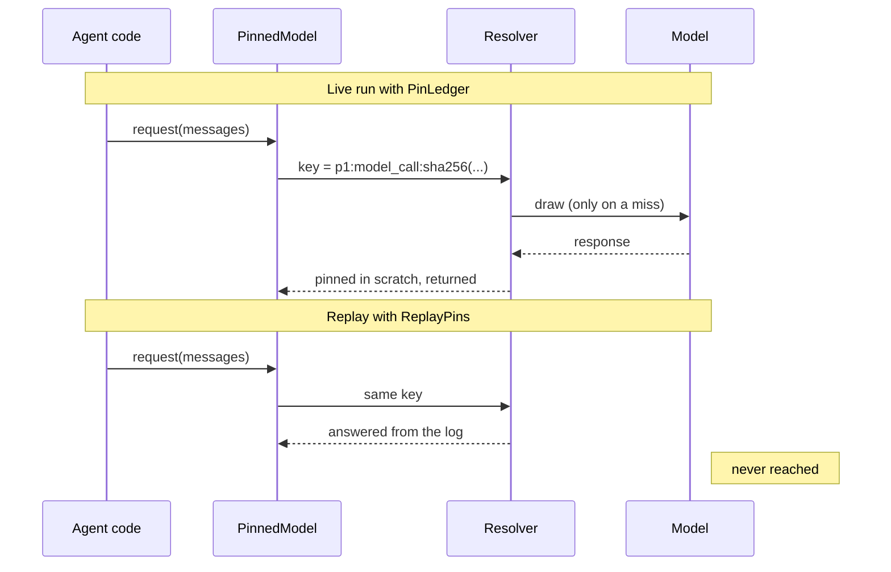
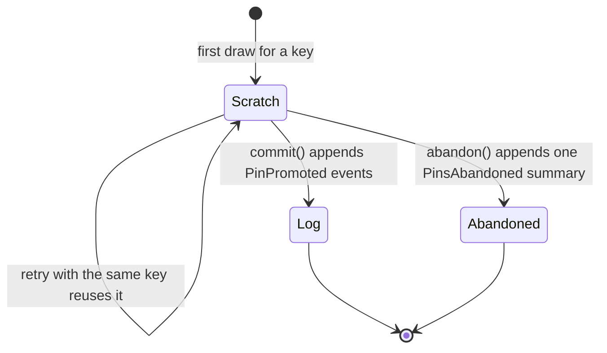

# Pinning and Replay

Model calls are slow, cost money and return different output for the same input, which makes an agent run impossible to reproduce. Pinning is how anagrapheus fixes that without replacing the model. This page explains what a pin is, how its key is derived, what replay does differently from simply running again, and where the judgment calls sit.

## What pinning means

To **pin** an effect is to record its result under a key, so that the effect happens once and everything afterwards reuses the record. The effects worth pinning are the nondeterministic ones: a model response, a tool that reads the outside world, a freshly minted random id.

The key is derived from *what was asked*, never from when or how it was asked. Two requests that ask the model the same thing get the same key, so the second reuses the first one's answer. A request that asks something different gets a different key, so it cannot be answered with a stale response.

That single rule gives two behaviours:

- **Within one unit of work, a retry reuses the draw.** If a turn fails halfway and you retry it, the model calls it already made are answered from their pins rather than drawn again.
- **Across runs, replay answers from the log.** Once a unit of work is committed, its pins are ordinary events in the log. A later run can be fed those events and will receive exactly the answers the original run received, without contacting the model.

## Replay is not running again

The two are easy to conflate, and the difference matters.

**Re-running** a recorded scenario calls the model again. With a real model you get different answers, so a bug seen on turn 37 may not reappear, and a test that re-runs is slow, flaky and billed.

**Replaying** answers every pinned call from the log. The model is not called. The same log and the same code produce the same run, and the effect function is never even invoked: under strict replay a missing pin raises before any call is made, so "no model was reached" is something a test can assert.

When the code has changed so that it now asks something new, the key no longer matches any pin. Replay treats this as the important event it is: the run has stopped being a replay.



Here is that cycle end to end, offline, with a scripted pydantic-ai `FunctionModel` standing in for the UK negotiator:

```python title="pinning_replay.py"
import asyncio
from pathlib import Path
from tempfile import TemporaryDirectory

from pydantic_ai import Agent
from pydantic_ai.messages import ModelMessage, ModelResponse, TextPart
from pydantic_ai.models.function import AgentInfo, FunctionModel

from anagrapheus import register_builtin_events
from anagrapheus.provider import PinnedModel
from anagrapheus.timeline import (
    EventTypeRegistry,
    PinLedger,
    PinMiss,
    ReplayPins,
    SQLiteEventStore,
)

calls = 0


def negotiator(messages: list[ModelMessage], info: AgentInfo) -> ModelResponse:
    global calls
    calls += 1
    return ModelResponse(parts=[TextPart("The UK holds firm on fisheries.")])


async def main() -> None:
    types = EventTypeRegistry()
    register_builtin_events(types)
    model = FunctionModel(negotiator, model_name="scripted-uk")

    with TemporaryDirectory() as tmp:
        # Record: the draw happens once, then the pin is promoted into the log.
        store = SQLiteEventStore(Path(tmp) / "run.db")
        ledger = PinLedger(store, types)
        agent = Agent(PinnedModel(model, ledger))
        await agent.run("Round 1: state the UK position on fisheries.")
        ledger.commit()

        # Replay: answer from the log; the model function is never called.
        replay = ReplayPins.from_events(store.read(), types)
        agent = Agent(PinnedModel(model, replay))
        result = await agent.run("Round 1: state the UK position on fisheries.")
        print(result.output, "| model calls:", calls)

        # A different question is a different key, so strict replay refuses it.
        try:
            await agent.run("Round 1: state the EU position on fisheries.")
        except PinMiss as miss:
            print("diverged after", miss.divergence.after_hits, "hit(s)")
        store.close()


asyncio.run(main())
```

```text
The UK holds firm on fisheries. | model calls: 1
diverged after 1 hit(s)
```

For a guided version of this, see [Getting Started](../tutorials/getting-started.md); for the procedure with recordings on disk, see [How to Record a Run and Replay It Offline](../how-to/record-and-replay.md).

## The life of a pin

A [`PinLedger`][pin-ledger] is the live resolver for one **unit of work**: whatever your application treats as one attempt, such as a turn, a round or a consolidation pass. Its id, `unit_id`, is a fresh UUIDv7 unless you supply one.



- **Draw.** The first time a key is seen, the effect runs and its result is written to the ledger's **scratch**, a table in the same database that survives a crash but is never part of the log. Nothing that reads the log can see it.
- **Reuse.** A second request with the same key, in the same unit of work, gets the scratch result back and the attempt count goes up. Concurrent requests for one key wait for the draw already in flight rather than both calling the model.
- **Commit.** [`commit()`][pin-ledger-commit] moves every scratch pin into the log as a [`PinPromoted`][pin-promoted] event and clears the scratch, in one transaction.
- **Abandon.** [`abandon(reason=...)`][pin-ledger-abandon] drops the scratch and appends a single [`PinsAbandoned`][pins-abandoned] event listing each discarded key and its attempt count. The log keeps an audit line, not a pile of provisional results.

Replay reads the other way. [`ReplayPins.from_events`][replay-from-events] collects the `PinPromoted` events from a stream (all of them, or one unit of work's), and answers each key from them. It implements the same resolver interface as the ledger, so the same agent code runs live, under retry and under replay without modification.

### Strict and record replay

[`ReplayPins`][replay-pins] has two postures for a key it has no pin for:

- **`on_miss="strict"`**, the default, raises [`PinMiss`][pin-miss] on every miss. Its `divergence` names the missed key, the kind of call, and how many pins were hit before it.
- **`on_miss="record"`** marks the first miss as the point of divergence and then lets the call through, drawing fresh. The run continues, announced as new rather than presented as a replay. It needs a [`PinLedger`][pin-ledger] passed as `into=`, and is refused without one: the new run is a unit of work like any other, so its fresh draws go through that ledger and the pins it replayed are adopted into the same scratch. When the ledger commits, its pins reach the log together with a [`ReplayDiverged`][replay-diverged] event, so the authoritative record says where the replay ended, and the new log replays the new run strictly.

Record mode is useful for controlled comparisons. Because the model's id is part of every key, swapping one role's model and replaying in record mode makes exactly that role's calls miss and draw again, while every other call replays as it was.

!!! warning "Models that share an id share pins"
    A key includes the model's id. Two models reporting the same id, such as two `FunctionModel`s built without distinct `model_name`s, will answer each other's pins. Give every scripted model a distinct `model_name`. Conversely, the same weights reached through a different provider route have a different id, so a corpus recorded through one route misses on every call through another.

## What counts as "the same call"

Pinning stands or falls on the key, and both ways of getting it wrong are silent:

- **Too much in the key** (a timestamp, a provider-assigned id) and every call gets a fresh key. Pinning appears to work, reuse never happens, nothing raises, and the bill is the only symptom.
- **Too little in the key** and two genuinely different calls collide, so the second is answered with the first one's response. This is the worse failure, because it returns a wrong answer with confidence.

The function that builds the key is [`pin_key(kind, material)`][pin-key]. It hashes the canonical JSON of `material` and produces a key of the form `p1:model_call:<sha256>`. The `p1` is a scheme number: changing the policy that builds material can be made visible by bumping it, so that every old key misses instead of silently matching.

What goes into `material` for a model call is decided by a [`CallPolicy`][call-policy], and that decision belongs to the application: only you know whether two requests in your domain are the same question. [`SemanticCallPolicy`][semantic-policy] is the default that [`PinnedModel`][pinned-model] uses when you supply none. It keeps:

- the semantic content of every message part,
- the model's id,
- the request parameters: the tool definitions (sorted by name, since the order is not something the model is told), the output schema, and anything else the model is told it may do or must produce,
- the effective model settings (the wrapped model's own merged with the run's), such as temperature, token limits, forced tool choice, and draw-changing `extra_body` entries such as OpenRouter reasoning or Anthropic `thinking`.

It drops the fields that differ between two runs of an identical call: part timestamps, part and provider ids, provider names and details, the provider-assigned `tool_call_id`, metadata, the settings that only affect delivery (timeout, extra headers, service tier and any prompt-cache setting), and the ids that name the session or end user behind a call. It reduces by exclusion rather than by listing known fields, so a part type or setting that a future pydantic-ai release adds is kept in the key until someone decides it is volatile. Keeping one field too many costs a redraw; dropping one that mattered would answer a call drawn under different terms.

The session and user ids it drops are `openai_user`, the `user_id` in `anthropic_metadata`, and these keys inside `extra_body`: `session_id` (OpenRouter's provider-affinity id), `user`, `safety_identifier` and `prompt_cache_key` (OpenAI's end-user and cache-routing fields), and `user_id` inside a `metadata` object. Such an id is usually derived per game or per session. If it were keyed, a run replayed or re-recorded under a new session id would miss every pin, and nothing would report it. Only those keys leave `extra_body`; everything else in it is still keyed, because draw-changing settings travel there too.

!!! info "Why the output schema is in the key"
    It can look as if an output schema is "how the response will be parsed" and should stay out of the key. It is not: a required output schema is sent to the model and changes what the model generates. What stays out is the parsing done after the draw, which the resolver keeps separate (see below).

??? info "Drawing and interpreting are kept apart"
    Every resolver method takes the effect and its interpretation together: [`resolve(key, kind=..., effect=..., interpret=...)`][pin-resolver-resolve]. The raw result is what gets pinned; the interpretation runs on every resolve, first draw, retry and replay alike. Changing how a result is interpreted therefore reuses the pinned raw value rather than drawing a new one. `PinnedModel` uses this to rebuild a `ModelResponse` from the stored JSON with exactly the code that handled the live response.

## Per request, not per run

`PinnedModel` pins each **request** to the model, not each agent run. A single pydantic-ai run with tools makes several requests: one that decides to call a tool, then one that reads the tool's result and answers. Each is its own draw, so each gets its own key.

Pinning only the final answer would replay the conclusion while re-running every step that reached it, including the tool calls, which are the part of a run that touches the world. Per-request pins let a multi-step run replay with the model reached zero times.

### Tools

A tool that reads the world is a nondeterministic effect too. [`pinned_tool(resolver, func)`][pinned-tool] wraps one so its result is drawn once and replayed thereafter. The key is the tool's name and its arguments, excluding any `RunContext` parameter, which is filled from the run rather than by the model.

Which tools to wrap is your judgment, and it matters in both directions:

- A tool that **reads the world** (a search, a fetch, a database query) should be pinned, so a replay sees what the run saw rather than what is true now.
- A **pure** tool needs no pin; it recomputes identically for free.
- A **deliberately live** tool (a clock, a current price) must not be pinned. A replay should show an old answer only where the old answer is what the run acted on.

The wrapper is always a coroutine function, whatever it wraps. pydantic-ai runs synchronous tools in a worker thread, and the ledger's SQLite connection belongs to the thread that opened it, so the wrapper touches the ledger on the calling thread and offloads only the tool body.

### Streaming

Streamed responses are pinned as their accumulated result. A stream's key is the key its non-streamed twin would have, because streaming is how a response is received, not part of what the model is asked; a pin recorded while streaming replays through a plain request, and the other way round. A stream the consumer abandons early, or one that fails midway, is still pinned, with the state the provider stamped on it, because a partial answer is something the model produced.

On replay, [`PinnedStreamedResponse`][pinned-stream] rebuilds a stream from the pinned response, so `run_stream()` and event stream handlers work as before. What it does not reproduce is the provider's chunk boundaries and timing: each part arrives whole and as fast as the consumer reads. Code that only consumes the content will not notice; code that acts on chunk boundaries is not replaying its stream.

### Ids are draws too

Minting a fresh entity id consumes entropy just like a model call. An unpinned mint draws a different id on replay, and every belief and pin keyed on the original entity is orphaned. The identity layer's [`mint_entity_id`][mint-entity-id], and [`establish`][establish] when given a resolver, draw the id through the ledger so a replayed run re-establishes the same entity. See [Identity](identity.md#minting-an-entity-id-is-a-draw).

## Recordings on disk

A replay needs only the pins, not the whole log. A fresh store will mint different ids for everything else anyway. [`write_recording`][write-recording] writes events to a JSON-lines file in the log's own serialisation: one header line describing the run (which provider route recorded it, how to re-record it), then one [`StoredEvent`][stored-event] per line in canonical JSON, so an unchanged re-recording produces a reviewable diff. [`pin_events(...)`][pin-events] filters a stream down to just the pins.

Because every line is a stored event, a recording is upcast as it is read, like any other log: pass `upcasts=` to `ReplayPins.from_events`. A recording made today therefore survives a later change to the pin event's schema.

!!! warning "Identifiers in prompts break replay on a fresh store"
    A pin is keyed on what the model is asked. If a prompt renders an entity id, a belief id or an event id, that text differs on every run against a fresh store, so every pin misses. Render human-readable fields instead. The negotiation example's prompts are built this way, which is what lets its committed recordings replay into an empty database.

## How this compares with the alternatives

| Approach | What it records | What breaks it | Same path as production? |
|---|---|---|---|
| HTTP cassettes (VCR-style) | The wire request and response | Any change to request framing, headers or SDK version; and a changed prompt simply misses with no record of where | No: test-only scaffolding that can drift from real behaviour |
| Response caching | The response under a hash you choose | Usually nothing announces a miss, so a changed prompt silently re-draws | Often, but with no unit of work, no audit trail and no replay mode |
| anagrapheus pins | The semantic result, in the event log, under a key derived from what was asked | A change to what is asked, which raises `PinMiss` (or announces divergence) at the exact call | Yes: live runs, retries and replays all go through the same resolver |

Wire-level cassettes still have one use pins cannot serve: catching a change in how an SDK frames a request. Pins record the meaning of a call, not its bytes.

## Where to go next

- [How to Pin Model and Tool Calls](../how-to/pin-model-and-tool-calls.md) covers wrapping models and tools and writing a custom call policy.
- [Prompt Assembly](prompt-assembly.md#assembly-changes-are-pin-misses) explains why any change to how a prompt is built shows up as a pin miss.
- [The Chronicle](chronicle.md#the-summariser-builds-the-key) explains how a generative fold pins its own model calls.

[pin-ledger]: ../reference/anagrapheus/timeline/pins.md#anagrapheus.timeline.pins.PinLedger
[pin-ledger-commit]: ../reference/anagrapheus/timeline/pins.md#anagrapheus.timeline.pins.PinLedger.commit
[pin-ledger-abandon]: ../reference/anagrapheus/timeline/pins.md#anagrapheus.timeline.pins.PinLedger.abandon
[pin-promoted]: ../reference/anagrapheus/timeline/pins.md#anagrapheus.timeline.pins.PinPromoted
[pin-key]: ../reference/anagrapheus/timeline/pins.md#anagrapheus.timeline.pins.pin_key
[replay-from-events]: ../reference/anagrapheus/timeline/replay.md#anagrapheus.timeline.replay.ReplayPins.from_events
[pin-miss]: ../reference/anagrapheus/timeline/replay.md#anagrapheus.timeline.replay.PinMiss
[write-recording]: ../reference/anagrapheus/timeline/recording.md#anagrapheus.timeline.recording.write_recording
[call-policy]: ../reference/anagrapheus/provider/policy.md#anagrapheus.provider.policy.CallPolicy
[semantic-policy]: ../reference/anagrapheus/provider/policy.md#anagrapheus.provider.policy.SemanticCallPolicy
[pinned-model]: ../reference/anagrapheus/provider/model.md#anagrapheus.provider.model.PinnedModel
[pinned-tool]: ../reference/anagrapheus/provider/tools.md#anagrapheus.provider.tools.pinned_tool
[pinned-stream]: ../reference/anagrapheus/provider/stream.md#anagrapheus.provider.stream.PinnedStreamedResponse
[mint-entity-id]: ../reference/anagrapheus/identity/decisions.md#anagrapheus.identity.decisions.mint_entity_id
[pins-abandoned]: ../reference/anagrapheus/timeline/pins.md#anagrapheus.timeline.pins.PinsAbandoned
[replay-pins]: ../reference/anagrapheus/timeline/replay.md#anagrapheus.timeline.replay.ReplayPins
[replay-diverged]: ../reference/anagrapheus/timeline/pins.md#anagrapheus.timeline.pins.ReplayDiverged
[pin-resolver-resolve]: ../reference/anagrapheus/timeline/pins.md#anagrapheus.timeline.pins.PinResolver.resolve
[establish]: ../reference/anagrapheus/identity/decisions.md#anagrapheus.identity.decisions.establish
[stored-event]: ../reference/anagrapheus/timeline/envelope.md#anagrapheus.timeline.envelope.StoredEvent
[pin-events]: ../reference/anagrapheus/timeline/recording.md#anagrapheus.timeline.recording.pin_events
