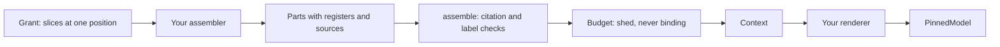

# Prompt Assembly

Prompt assembly decides what a model is shown. In a multi-agent run that is also where private information leaks, quietly, into the wrong agent's prompt. This page explains how anagrapheus builds a context from **grants** and **slices** so that a role can show its model only what it was allowed to read, and so that every context can say where each piece came from.

## The problem with building prompts by hand

The usual way to build a prompt is a function that reaches into whatever state it needs and formats some strings. In a simulation where agents hold private beliefs, that has three failure modes, all silent:

- **A firewall on the readers is not a firewall on the prompt.** You can make sure the UK's code can only read the UK's beliefs, and still leak the EU's private knowledge through a shared summary that is pasted into every prompt. Nothing fails, because nothing compares what the prompt contains with what the role was allowed to see.
- **Canon and generated prose look alike.** A chronicle summary written by a model reads exactly like a fact from the log once it is formatted beside one. Whether a sentence is binding or advisory is structure, not wording, and a string loses the structure.
- **Reads drift.** If beliefs move while a prompt is being built, half the context describes the world before an event and half after it.

anagrapheus addresses all three by making assembly read only through objects that record what they hand out, all at one **position** in the log (one `seq`). What they read are **projections**: state such as beliefs or chronicle sections, folded from the event log and rebuildable from it (see [The Event Log and Projections](event-log-and-projections.md)).

## The vocabulary

- A **slice** is one read-only source, opened at one log position, that remembers everything it returns.
- A **grant** is the set of slices one role may read for one call, bundled in a frozen dataclass.
- A **part** is one structured piece of context, with a **register** saying how binding it is, a **rank** for ordering within that register, and the **sources** it was built from.
- A **budget** is the size limit for a context, and the order in which parts may be dropped to meet it.
- A **context** is the result: the parts that survived, the parts that were shed, and everything the grant's slices handed out.

Your **assembler** is a function from a grant to parts. [`assemble(role, assembler, grant, budget=...)`][assemble] runs it and checks what it produced. You render the context into messages and send them through [`PinnedModel`][pinned-model] as you would any other prompt.

## Grants: a role reads only what it was given

A grant is a frozen dataclass whose every field is a slice. `assemble` refuses anything else: a field holding a store or a table would be a way round every other check, and a grant that is not frozen could have a slice swapped for a store after it was checked.

The library provides five slices in `anagrapheus.assembly`:

- [`LogSlice`][log-slice]: events up to `upto_seq` that an `admit(envelope)` predicate accepts. `admit` sees only the stored envelope, so an excluded event is never even decoded. This is where you keep a private event (a side remark only one party overheard) out of a shared prompt.
- [`BeliefSlice`][belief-slice]: beliefs from the scopes a `visible(scope_id)` predicate accepts. Asking for any other scope raises [`NotGranted`][not-granted].
- [`ChronicleSlice`][chronicle-slice]: chronicle sections reaching no further than `upto_seq`.
- [`EventsSlice`][events-slice]: a fixed run of events, filtered by `admit`, for a summariser that is handed its range rather than reading the log.
- [`Given`][given]: a value your application hands in that no projection produced, such as another role's pinned output, optionally citing the event it came from.

Any object with an `upto_seq` property and a `handed_out()` method satisfies the [`Slice`][slice] protocol, so your own readers can take part too. The negotiation example's per-party view is one.

A role holds the slices it declares and nothing else. A role granted only two `Given` values, such as its instructions and a window of recent text, has no belief slice to misuse, however its code is written. That is a dependency rule enforced at runtime, one level below anything an import linter could check.

### Every slice records what it handed out

Reading through slices rather than stores is what makes provenance free. Each slice records every event, belief state, section or given value it returns, and the context's `read` field collects them all. Because the slices fill it, not the assembler, it does not depend on the assembler being honest.

That turns a leak into something a test can assert: "no `SideRemarkOverheard` event appears in the speaker's context". The assertion is on sources, not wording, so it still holds when the rendering changes.

### One position, one call

A context should describe one moment of the log. So:

- All slices in a grant must agree on their position; slices at different positions raise [`AssemblyError`][assembly-error].
- A belief slice reads a live store, so it is given a way to ask how far the belief fold has got (the projector's `position` for the fold's name, which [`BeliefSlice.over`][belief-slice-over] wires for you). It raises [`StaleRead`][stale-read] if an event the fold claims lies between the fold's position and the slice's: behind means you should catch up before assembling; ahead means a belief event was appended mid-assembly. An event no belief comes from, such as a promoted pin, cannot tear a context, so the fold may be behind or ahead by any number of those. Only envelopes are read to decide this.
- A grant is read for one assembly. `assemble` refuses a grant whose slices have already handed something out, so a context's `read` is exactly this call's reads.

## Parts, registers and citations

A [`Part`][part] holds structured `content`, not pre-rendered text. Keeping it structured lets you change the rendering, or compare two renderings, while the structure stays fixed.

Its [`Register`][register] says what kind of thing it is:

| Register | Meaning | May the budget shed it? |
|---|---|---|
| `binding` | Must hold: invariants, the rules of the game | Never |
| `considered` | Advisory, ranked | Yes, first by default |
| `craft` | Technique, loaded when relevant | Yes, last by default |
| `generated` | Prose a model wrote, such as a chronicle section | Yes; and always labelled as such |

`assemble` checks every part's sources against what the grant actually handed out:

- A part citing something no slice returned raises [`UncitedSource`][uncited-source]. A part cannot claim a source it never read.
- A part citing a chronicle section under any register other than `generated` raises [`MislabelledPart`][mislabelled-part].
- Every section a slice handed out must be cited by some `generated` part, or `assemble` raises `MislabelledPart`. Otherwise prose could slip in under another register simply by leaving its citation off.

!!! info "The limit of checking structure"
    These checks see sources, not text. An assembler that cites a section in a `generated` part and also copies its words into a `binding` part would pass. Structure can make the honest path the easy one; it cannot read prose.

## The budget never sheds binding parts

A [`Budget`][budget] takes your token counter (`count(part) -> int`), a `total`, and an `order` of registers to shed. The default order is `considered`, then `generated`, then `craft`. Within a register, the lowest `rank` goes first, and among equal ranks, the later part. `binding` may not appear in the order.

If the binding parts alone exceed the total, or the context is still too large after shedding everything sheddable, `assemble` raises [`BudgetExceeded`][budget-exceeded]. A call that cannot carry its own invariants is not made: a loud refusal is better than a prompt that silently drops a rule.

The context records what was dropped in `shed`. "What was the model *not* shown?" is often the first question after a bad turn.

## Rendering is yours

Turning a context into messages is your application's job; the library fixes the structure of a context, not its wording. [`render_labelled`][render-labelled] is a plain default that returns one string with each register under its own heading (the `generated` heading says the prose is advisory and not canon). It is enough for tests and a first version; replace it when your prompts need more care.

## Determinism is the contract

An assembler must be a pure function of its grant. Slices read at one position, and everything under them is either a deterministic fold or a pin, so **the same log at the same position gives the same context, part for part**. The rendered bytes are then the same, which is what lets a replay hit its pins.

The library cannot check that your assembler is pure. A golden test can: [`Context.describe()`][context-describe] returns the context as plain data (parts, registers, ranks, sources, what was shed and read), suitable for comparing against a committed expectation built from a fixture log. Comparing structure rather than rendered text keeps the test stable when wording changes.

A `generated` part is only as stable as its pin. A chronicle rebuilt without its pins has different prose, so a context built over it changes too. That is correct, because a different summary is a different prompt, and the context's sources say which sections it used.

### Assembly changes are pin misses

Pin keys are derived from the content of a request. Any change to how a prompt is assembled (a new part, a different rank order, a reworded renderer) changes the rendered messages, so the key changes and replay reports a miss at that call. Nothing about pinning is special to assembly; this is the same mechanism described in [Pinning and Replay](pinning-and-replay.md), and it is what makes an assembly change visible instead of silently re-drawn.

### The context is not logged; it can be rebuilt

`assemble` does not append the context to the log. A context is derived from the log, and a projection's output does not belong in the log it projects from. Because assembly is deterministic, the context any call was shown can be reassembled from the same grant at the same position, as long as the assembler code is the version that ran. Once the assembler changes, an old call's exact context can no longer be rebuilt that way.

## What prompt assembly is not

- **Not a chat transcript.** Each call gets a fresh context assembled from projections. Nothing accumulates message history across turns. A tool loop within one call is pydantic-ai's and is already pinned per request.
- **Not retrieval.** An assembler consumes ranked results, for example from the chronicle's [`Retriever`][retriever] port. It does not rank anything itself.

## What the library decides, and what you decide

| The library | Your application |
|---|---|
| Reading through slices at one position, and recording what they hand out | Which roles exist and what each is granted |
| Refusing non-slice or unfrozen grants, mixed positions, reused grants | `admit` and `visible` predicates: what each role may see |
| Citation and register checks | Slot names, part content, ranks |
| A budget pass that never sheds binding parts and reports what it shed | The token counter and the total |
| A plain default renderer | Rendering parts into messages |

For the procedure, see [How to Assemble Prompts from Granted Slices](../how-to/assemble-prompts.md).

[assemble]: ../reference/anagrapheus/assembly/assemble.md#anagrapheus.assembly.assemble.assemble
[budget]: ../reference/anagrapheus/assembly/assemble.md#anagrapheus.assembly.assemble.Budget
[pinned-model]: ../reference/anagrapheus/provider/model.md#anagrapheus.provider.model.PinnedModel
[log-slice]: ../reference/anagrapheus/assembly/slices.md#anagrapheus.assembly.slices.LogSlice
[belief-slice]: ../reference/anagrapheus/assembly/slices.md#anagrapheus.assembly.slices.BeliefSlice
[belief-slice-over]: ../reference/anagrapheus/assembly/slices.md#anagrapheus.assembly.slices.BeliefSlice.over
[chronicle-slice]: ../reference/anagrapheus/assembly/slices.md#anagrapheus.assembly.slices.ChronicleSlice
[events-slice]: ../reference/anagrapheus/assembly/slices.md#anagrapheus.assembly.slices.EventsSlice
[given]: ../reference/anagrapheus/assembly/slices.md#anagrapheus.assembly.slices.Given
[slice]: ../reference/anagrapheus/assembly/slices.md#anagrapheus.assembly.slices.Slice
[part]: ../reference/anagrapheus/assembly/parts.md#anagrapheus.assembly.parts.Part
[register]: ../reference/anagrapheus/assembly/parts.md#anagrapheus.assembly.parts.Register
[context-describe]: ../reference/anagrapheus/assembly/parts.md#anagrapheus.assembly.parts.Context.describe
[render-labelled]: ../reference/anagrapheus/assembly/render.md#anagrapheus.assembly.render.render_labelled
[not-granted]: ../reference/anagrapheus/assembly/errors.md#anagrapheus.assembly.errors.NotGranted
[assembly-error]: ../reference/anagrapheus/assembly/errors.md#anagrapheus.assembly.errors.AssemblyError
[stale-read]: ../reference/anagrapheus/assembly/errors.md#anagrapheus.assembly.errors.StaleRead
[uncited-source]: ../reference/anagrapheus/assembly/errors.md#anagrapheus.assembly.errors.UncitedSource
[mislabelled-part]: ../reference/anagrapheus/assembly/errors.md#anagrapheus.assembly.errors.MislabelledPart
[budget-exceeded]: ../reference/anagrapheus/assembly/errors.md#anagrapheus.assembly.errors.BudgetExceeded
[retriever]: ../reference/anagrapheus/chronicle/reading.md#anagrapheus.chronicle.reading.Retriever
