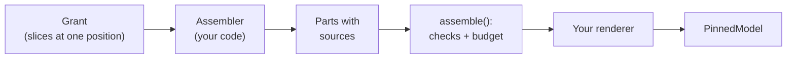

# How to Assemble Prompts from Granted Slices

This guide shows how to build an agent's prompt so that it can contain only what that agent is allowed to see, every piece of it records its sources, and a size budget drops the least important pieces first. The example builds Norway's prompt in a fisheries negotiation: Norway may read the offers made in the room and its own private beliefs, never the UK's.

**Before you start**

- Beliefs set up as in [How to Keep Per-Agent Beliefs as a Fold](per-agent-beliefs.md).
- The vocabulary used below:
    - a **slice** reads one source (the log, a belief store, the chronicle, or a value you hand in) at one log position, and remembers everything it returned;
    - a **grant** is the set of slices a role may read: a frozen dataclass whose every field is a slice;
    - a **part** is one structured piece of the prompt, with a slot name, a **register**, a rank and its sources;
    - the **register** says how binding a part is: `binding` (must hold), `considered` (advisory, ranked), `craft` (technique) or `generated` (prose a model wrote);
    - the **budget** is the size limit, and decides which parts are shed when the prompt is too big.

    [Prompt Assembly](../explanation/prompt-assembly.md) explains each of these.

## Who decides what

| The application decides | The library does |
|---|---|
| Each role's grant: which slices, which scopes, which events | Refusing reads outside the grant |
| The assembler: which parts, in which slots and registers | Checking every part cites only what was read |
| Rendering parts into messages | Refusing chronicle prose under any register but `generated` |
| The budget's size, its token counter and shed order | Shedding by register and rank, never a `binding` part |



## 1. Bring the projections to the position you will read at

Every slice in a grant reads at one log position. A belief slice refuses to read unless the belief fold is exactly there, so run the projector first and read at the log's last position:

```python title="assemble_prompts.py"
import uuid
from dataclasses import dataclass

from doxastica import InMemoryBackend, MemoryCore
from pydantic_ai import Agent
from pydantic_ai.messages import ModelMessage, ModelResponse, TextPart
from pydantic_ai.models.function import AgentInfo, FunctionModel

from anagrapheus import register_builtin_events
from anagrapheus.assembly import (
    BeliefSlice,
    Budget,
    EventRef,
    Given,
    LogSlice,
    Part,
    Register,
    assemble,
    render_labelled,
)
from anagrapheus.beliefs import (
    FOLD_NAME,
    BeliefEvents,
    BeliefFold,
    Predicate,
    PredicateKind,
    PredicateRegistry,
    SQLiteBeliefIndexStore,
    StateRef,
)
from anagrapheus.provider import PinnedModel
from anagrapheus.timeline import (
    DomainEvent,
    EventReader,
    EventTypeRegistry,
    PinLedger,
    Projector,
    SQLiteEventStore,
    UpcastRegistry,
)


class OfferMade(DomainEvent, frozen=True):
    party: str
    text: str


types = EventTypeRegistry()
register_builtin_events(types)
types.event("fisheries", "OfferMade")(OfferMade)
predicates = PredicateRegistry(
    [Predicate("position", 2, PredicateKind.FUNCTIONAL)], namespace="fisheries"
)
store = SQLiteEventStore(":memory:")
reader = EventReader(store, UpcastRegistry(), types)
fold = BeliefFold(
    MemoryCore(InMemoryBackend()),
    predicates,
    SQLiteBeliefIndexStore(store.connection),
    types,
)
projector = Projector(store, reader, [fold])

uk, mackerel = uuid.uuid7(), uuid.uuid7()
beliefs = BeliefEvents(types, predicates)
store.append(
    [
        beliefs.revise(
            "party:norway:held", "position", (uk, mackerel), "UK will settle at 8%"
        ),
        beliefs.revise("party:uk:held", "position", (uk, mackerel), "cut 5%"),
        types.pending(OfferMade(party="UK", text="A 12% cut to the mackerel quota.")),
    ]
)
projector.catch_up()
```

## 2. Define the role's grant

A grant is a frozen dataclass of slices. Build a fresh one for every assembly, since a slice's record of what it handed out belongs to one call:

```python title="assemble_prompts.py (continued)"
# 1. The grant: everything Norway's negotiator may read, and nothing else.
@dataclass(frozen=True)
class NorwayGrant:
    room: LogSlice
    own_beliefs: BeliefSlice
    ask: Given[str]


def norway_grant(upto_seq: int) -> NorwayGrant:
    return NorwayGrant(
        room=LogSlice(
            reader,
            upto_seq=upto_seq,
            admit=lambda env: (env.namespace, env.type) == ("fisheries", "OfferMade"),
        ),
        own_beliefs=BeliefSlice(
            fold.store,
            visible=lambda scope: scope == "party:norway:held",
            upto_seq=upto_seq,
            folded_through=lambda: store.read_position(FOLD_NAME),
        ),
        ask=Given("ask", "Respond to the latest offer in one sentence."),
    )
```

The slices used here:

- [`LogSlice`][log-slice] reads events up to `upto_seq` that `admit` accepts. `admit` sees only the envelope, so a refused event is never even decoded. This is where a private event is kept out of a shared prompt.
- [`BeliefSlice`][belief-slice] reads the scopes `visible` accepts. `folded_through` reports how far the belief fold has got, and the slice refuses to read if that is not `upto_seq`.
- [`Given`][given] wraps a value your application computed, such as the instruction.

Two more slices exist: [`ChronicleSlice`][chronicle-slice] for chronicle sections, and [`EventsSlice`][events-slice] for a fixed run of events, such as the range a summariser is given.

## 3. Write the assembler

The assembler is a function from the grant to parts. It must be pure: the same log, position and grant must give the same parts, or replay will miss its pins. Cite each part's sources with the reference the slice handed out:

```python title="assemble_prompts.py (continued)"
# 2. The assembler: parts with a register, a rank and their sources.
def norway_assembler(grant: NorwayGrant) -> list[Part]:
    parts = [Part("ask", Register.binding, grant.ask.value, sources=(grant.ask.ref,))]
    for state in grant.own_beliefs.scope("party:norway:held"):
        parts.append(
            Part(
                "belief",
                Register.considered,
                state.value,
                rank=2,
                sources=(StateRef.of(state),),
            )
        )
    for stored, offer in grant.room.events():
        parts.append(
            Part(
                "offer",
                Register.considered,
                f"{offer.party}: {offer.text}",
                rank=1,
                sources=(EventRef(stored.seq, stored.envelope.event_id),),
            )
        )
    return parts
```

A [`Part`][part]'s content stays structured: a string here, but any JSON value is allowed. How it becomes text is your renderer's decision. `rank` orders parts within a register for the budget, and a higher rank survives longer.

## 4. Assemble within a budget

[`assemble`][assemble] runs the assembler over the grant, checks the result, and fits it to a [`Budget`][budget]. The budget's `count` is your token counter; this example counts characters:

```python title="assemble_prompts.py (continued)"
budget = Budget(total=120, count=lambda part: len(str(part.content)))
context = assemble(
    "norway", norway_assembler, norway_grant(store.last_seq()), budget=budget
)
prompt = render_labelled(context)
print(prompt)
print("shed:", [p.slot for p in context.shed])
print("read:", len(context.read))
```

```text
MUST HOLD:
Respond to the latest offer in one sentence.

CONSIDER:
UK will settle at 8%
UK: A 12% cut to the mackerel quota.
shed: []
read: 3
```

With `total=80` the parts no longer fit, and the budget sheds the lowest-ranked `considered` part, the offer, first. A `binding` part is never shed. The default shed order is `considered`, then `generated`, then `craft`; pass `order=` to change it.

[`render_labelled`][render-labelled] is a plain default that writes each register under a heading. Replace it with your own renderer; the wording is not part of any contract.

## 5. Send the prompt through the pinned model

Rendering is deterministic, so the same context gives the same bytes and a replay hits its pins. Send the result through `PinnedModel` as usual:

```python title="assemble_prompts.py (continued)"
def norway_model(messages: list[ModelMessage], info: AgentInfo) -> ModelResponse:
    return ModelResponse(parts=[TextPart("Norway can accept 6%, no more.")])


ledger = PinLedger(store, types)
print(Agent(PinnedModel(FunctionModel(norway_model), ledger)).run_sync(prompt).output)
ledger.commit()
```

Any change to what the assembler builds changes the prompt, and therefore the key: an assembly change shows up on replay as a `PinMiss`, not as a silently different answer.

## Verify it worked

`context.read` lists every source the grant's slices handed out during this assembly, whether or not a part cites it. It is filled by the slices themselves, so it does not depend on the assembler being honest. That makes it the thing to test when the question is whether a prompt leaked:

```python
read = context.describe()["read"]
assert all(source.get("scope") != "party:uk:held" for source in read)
```

`context.describe()` returns the whole context (parts, shed parts and sources) as plain data, ready for a golden test or a log line.

## Put chronicle prose in a prompt

A `ChronicleSlice` returns model-written sections. Any part built from one must be `Register.generated` and must cite the section, so that summarised prose can never pass as canon:

```python
from anagrapheus.assembly import ChronicleSlice, SectionRef


@dataclass(frozen=True)
class HistoryGrant:
    past: ChronicleSlice


def history(grant: HistoryGrant) -> list[Part]:
    parts = []
    for section in grant.past.sections():
        anchor = section.anchor
        source = SectionRef(anchor.section_id, anchor.from_seq, anchor.to_seq)
        parts.append(
            Part("past", Register.generated, section.prose, sources=(source,))
        )
    return parts
```

`render_labelled` puts generated parts under `SUMMARISED (advisory prose, not canon):`.

## Troubleshooting

### `StaleRead: the belief fold is at 4 and this slice reads at 5`

The belief fold is not at the slice's position. Run `projector.catch_up()` immediately before building the grant at `store.last_seq()`. Watch for appends you did not think of: committing a `PinLedger` appends `PinPromoted` events, which move `last_seq()` past the fold's position until the projector runs again.

### `NotGranted: scope 'party:uk:held' is not in this grant`

The assembler asked a belief slice for a scope its `visible` function rejects. This is the firewall working. Fix the assembler, or widen the grant if the role really may read that scope.

### `UncitedSource: part 'made-up' cites EventRef(…), which this grant never handed out`

A part cites something its slices did not return during this call. Cite only references built from what the slices returned.

### `MislabelledPart: part 'past' cites chronicle prose as considered`

Chronicle prose must be `Register.generated`. The same error is raised when a section was read but no generated part cites it, so leaving the citation off is not a way round it.

### `BudgetExceeded: the binding parts alone come to 44 against a total of 10`

The `binding` parts alone exceed the budget. Binding parts are never shed, so the call is refused rather than sent without its invariants. Raise the budget or make the binding parts smaller.

### `AssemblyError: this grant was already read from`

A grant was reused. Build a new grant for every assembly. The same exception type, with a different message, is raised when the slices in one grant read at different positions.

## Related

- [How to Keep Per-Agent Beliefs as a Fold](per-agent-beliefs.md): the scopes a belief slice reads.
- [How to Consolidate History into Chronicle Sections](chronicle-sections.md): the sections a chronicle slice reads.
- [How to Pin Model and Tool Calls](pin-model-and-tool-calls.md): the pinned model the rendered prompt goes through.
- [Prompt Assembly](../explanation/prompt-assembly.md): why a role reads only what it was granted.

[log-slice]: ../reference/anagrapheus/assembly/slices.md#anagrapheus.assembly.slices.LogSlice
[belief-slice]: ../reference/anagrapheus/assembly/slices.md#anagrapheus.assembly.slices.BeliefSlice
[chronicle-slice]: ../reference/anagrapheus/assembly/slices.md#anagrapheus.assembly.slices.ChronicleSlice
[events-slice]: ../reference/anagrapheus/assembly/slices.md#anagrapheus.assembly.slices.EventsSlice
[given]: ../reference/anagrapheus/assembly/slices.md#anagrapheus.assembly.slices.Given
[part]: ../reference/anagrapheus/assembly/parts.md#anagrapheus.assembly.parts.Part
[assemble]: ../reference/anagrapheus/assembly/assemble.md#anagrapheus.assembly.assemble.assemble
[budget]: ../reference/anagrapheus/assembly/assemble.md#anagrapheus.assembly.assemble.Budget
[render-labelled]: ../reference/anagrapheus/assembly/render.md#anagrapheus.assembly.render.render_labelled

<!-- INTERNAL NOTES FOR EDITOR - DO NOT INCLUDE IN RENDERED OUTPUT
## Page Classification
- Type: how-to
- Reference used: skills/diataxis/references/how-to-guides.md

## Source References
- src/anagrapheus/assembly/slices.py, parts.py, assemble.py, render.py, errors.py
- examples/negotiation/story.py (summarising() uses EventsSlice + assemble)
- Verified scripts: scratchpad docs-examples/howto/assemble_prompts.py, assemble_errors.py

## Accuracy Notes
- Inventory said "audit with handed_out". `handed_out` exists (anagrapheus.assembly.handed_out over slices), but the per-call audit a reader wants is `Context.read` / `Context.describe()["read"]`, which is what the page uses.
- Inventory listed `NotGranted` among assemble's refusals: it is raised by BeliefSlice._read for a scope outside `visible`, i.e. at read time inside the assembler, not by assemble() itself. Page describes it that way.
- StaleRead after ledger.commit(): reproduced. Committing appended PinPromoted at seq 4 while the belief fold position stayed at 3, so the next assembly at last_seq() raised StaleRead until catch_up ran. Real sharp edge, documented.
- total=80 sheds the offer (rank 1); verified in assemble_errors.py.
- The leak-test fragment depends on describe()'s "scope" key for StateRef sources (parts.py _source). Verified describe output shape.
- The ChronicleSlice fragment verified in assemble_fragments.py against a hand-appended Section.

## Known Limitations
- An application's own reader can be a slice (Slice protocol: upto_seq + handed_out); not demonstrated.

## API Reference Links Used
- anagrapheus.assembly.slices.LogSlice, BeliefSlice, ChronicleSlice, EventsSlice, Given
- anagrapheus.assembly.parts.Part
- anagrapheus.assembly.assemble.assemble, Budget
- anagrapheus.assembly.render.render_labelled
-->
