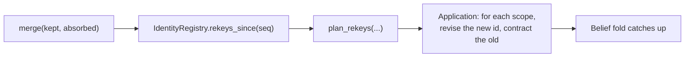

# How to Resolve Identity and Re-key Beliefs After a Merge

This guide shows how to record that two entities are the same one, and then carry the beliefs that named the absorbed entity over to the survivor. The example: transcripts from two days of talks call one party "UK delegation" and "British delegation", other parties have formed beliefs about each, and the application decides they are one party.

**Before you start**

- Beliefs set up as in [How to Keep Per-Agent Beliefs as a Fold](per-agent-beliefs.md).
- The vocabulary used below:
    - identity **decisions** are events: the identity registry is a fold over them, so a decision is auditable and the registry can be rebuilt;
    - to **establish** is to declare a new entity and mint its id; to **resolve** is to find which entity a name already refers to;
    - a **merge** records that two entity ids name one referent, with one **kept** and one **absorbed**; an **unmerge** withdraws a merge; a **split** records that one id named several;
    - to **re-key** is to move a belief whose id names the absorbed entity onto the id that names the survivor.

    [Identity](../explanation/identity.md) explains each of these.

## Who decides what

| The application decides | The library does |
|---|---|
| Whether two names are one entity (the judgment itself) | Recording the decision as an event |
| Which entity survives a merge | Following merge chains to the surviving id |
| Which scopes to re-key, and how (revise, contract, keep the old) | Listing every belief id that names the absorbed entity |
| Which product a belief belongs to after a split | Computing each belief's successor id or ids |
| Whether a merge was a mistake | Withdrawing it, and listing the beliefs that must be decided again |

The library computes the re-key plan and stops there. Applying it changes beliefs, and what should happen to them is a judgment about belief that only the application can make.



## 1. Wire the identity fold beside the belief fold

The identity registry is a projection like any other: an [`IdentityFold`][identity-fold] over the log, read through an [`IdentityRegistry`][identity-registry]. Its tables, and the belief fold's entity index, share the log's SQLite file.

```python title="identity.py"
import uuid

from doxastica import BeliefFilter, InMemoryBackend, MemoryCore

from anagrapheus import register_builtin_events
from anagrapheus.beliefs import (
    BeliefEvents,
    BeliefFold,
    BeliefIndex,
    Predicate,
    PredicateKind,
    PredicateRegistry,
    SQLiteBeliefIndexStore,
    plan_rekeys,
)
from anagrapheus.identity import (
    IdentityFold,
    IdentityRegistry,
    SQLiteIdentityStore,
    establish,
    merge,
)
from anagrapheus.timeline import (
    EventReader,
    EventTypeRegistry,
    Projector,
    SQLiteEventStore,
    UpcastRegistry,
)

types = EventTypeRegistry()
register_builtin_events(types)
predicates = PredicateRegistry(
    [Predicate("position", 2, PredicateKind.FUNCTIONAL)], namespace="fisheries"
)

store = SQLiteEventStore(":memory:")
reader = EventReader(store, UpcastRegistry(), types)
identity_store = SQLiteIdentityStore(store.connection)
index_store = SQLiteBeliefIndexStore(store.connection)
beliefs = BeliefFold(MemoryCore(InMemoryBackend()), predicates, index_store, types, durable=False)
projector = Projector(store, reader, [IdentityFold(identity_store, types), beliefs])
registry = IdentityRegistry(identity_store)
events = BeliefEvents(types, predicates)
```

Put the identity fold first in the list, so identity decisions are folded before the beliefs that follow them in the same batch.

## 2. Establish entities, and form beliefs about them

[`establish`][establish] mints an entity id and returns it with the event to append. Beliefs then name entities by id:

```python title="identity.py (continued)"
# Two names arrive from two transcripts, so they are established separately.
uk, uk_event = establish(types, "UK delegation", provenance="transcript:day-1")
britain, britain_event = establish(types, "British delegation", provenance="transcript:day-2")
mackerel, mackerel_event = establish(types, "mackerel quota", provenance="agenda")
store.append([uk_event, britain_event, mackerel_event])
store.append(
    [
        events.revise("party:eu:held", "position", (uk, mackerel), "will accept 8%"),
        events.revise("party:norway:held", "position", (britain, mackerel), "wants 12%"),
    ]
)
projector.catch_up()
before_merge = store.last_seq()
```

`provenance` is an opaque string for your own audit trail. The library never interprets it.

!!! tip "Pin the mint when the run will be replayed"
    Minting an entity id is a random draw. Without a resolver, a replayed run mints different ids, and every belief and pin keyed on the originals is orphaned. Pass the run's resolver and stable `material`, such as the source record's own id, so a replay establishes the same entity:

    ```python
    entity_id, event = establish(
        types,
        "Faroe Islands",
        provenance="agenda",
        resolver=ledger,
        material={"source_id": "agenda-7"},
    )
    ```

    Do not leave `material` at its default when two distinct records could share a name and a provenance: they would be minted as one entity.

## 3. Record the merge

When the application has judged that "British delegation" is the UK delegation, append a [`merge`][merge] decision and bring the projections up to date:

```python title="identity.py (continued)"
# The application judges that the two names are one party.
store.append([merge(types, kept=uk, absorbed=britain)])
projector.catch_up()

print(
    registry.canonical(britain) == uk,
    registry.resolve("British delegation").sole() == uk,
)
# True True
```

After the merge:

- [`registry.canonical(id)`][canonical] follows the merge chain to the surviving id;
- [`registry.resolve(name)`][resolve] returns the candidates a name matches, with merged entities collapsed into one, and `.sole()` returns the single candidate or raises;
- the absorbed entity's names now belong to the survivor, and [`registry.history(id)`][history] keeps the record of every decision.

Matching in `resolve` is exact on the Unicode-normalised name. The library never guesses that two different names are one entity.

Pass the registry as `identity=` and `merge` checks, before the event exists, that the merge would not close a cycle. Merging the UK delegation back into the British one now would leave neither with a canonical id, so it is refused:

```python title="identity.py (continued)"
from anagrapheus.identity import MergeCycle

try:
    merge(types, kept=britain, absorbed=uk, identity=registry)
except MergeCycle as error:
    print(type(error).__name__)
# MergeCycle
```

With the registry, `merge` also raises [`AlreadyMerged`][already-merged] for an entity that is already merged, into the same survivor or another: unmerge it first. The checks read the registry, so catch the projector up before you make them.

## 4. Plan the re-keys

The merge leaves Norway's belief keyed on the absorbed id. [`rekeys_since(seq)`][rekeys-since] lists the identity decisions after `seq` that invalidate keys, and [`plan_rekeys`][plan-rekeys] turns them into the belief ids affected and what each becomes:

```python title="identity.py (continued)"
rekeys = registry.rekeys_since(before_merge)
print(rekeys)
plans = plan_rekeys(rekeys, BeliefIndex(index_store), predicates)
for plan in plans:
    print(plan.kind, plan.belief_id, "->", plan.sole())
```

```text
[RekeyRow(seq=6, kind='merge', from_entity=UUID('…britain…'), to_entity=UUID('…uk…'))]
merge v1:fisheries:position(…britain…,…mackerel…) -> v1:fisheries:position(…uk…,…mackerel…)
```

Keep the `seq` you last re-keyed up to, and pass it to `rekeys_since` next time, so each decision is planned once.

## 5. Apply the plan in every scope

A plan says "belief id X becomes Y". It cannot say in which scopes, because the index records what was minted, not who holds it, and the belief store cannot list its scopes. Your application knows who is at the table, so this loop is yours:

```python title="identity.py (continued)"
# Applying the plan is the application's loop: which scopes, and how.
scopes = ["party:eu:held", "party:norway:held"]
for plan in plans:
    new = predicates.parse(plan.sole())
    old = predicates.parse(plan.belief_id)
    for scope in scopes:
        for state in beliefs.store.query_scope(scope, BeliefFilter()):
            if state.belief_id != plan.belief_id:
                continue
            store.append(
                [
                    events.revise(
                        scope,
                        new.name,
                        new.entity_ids,
                        state.value,
                        stance=state.stance,
                    ),
                    events.contract(scope, old.name, old.entity_ids),
                ]
            )
projector.catch_up()
```

This loop makes three decisions on the application's behalf, and yours may differ:

- A scope that never held the old belief is skipped, not given a default.
- The value and the stance carry over unchanged.
- The old belief is contracted in the same batch, so the move is atomic and both events are in the log.

This loop assumes each belief names at most one re-keyed entity. For the general case, including a belief that names two re-keyed entities and a chooser for split plans, see `apply_rekeys` in the repository's `examples/negotiation/rekeying.py`.

Re-key through events, as here, never by writing to the belief store directly: a direct write would skip the entity index and the log, and vanish on the next rebuild.

## Verify it worked

Every scope's belief now names the survivor, and the audit trail records the merge:

```python title="identity.py (continued)"
for scope in scopes:
    for state in beliefs.store.query_scope(scope, BeliefFilter()):
        print(scope, predicates.parse(state.belief_id).entity_ids[0] == uk, state.value)
print([row.kind for row in registry.history(uk)])
```

```text
party:eu:held True will accept 8%
party:norway:held True wants 12%
['established', 'merged']
```

## After a split, choose the successor

A [`split`][split] decision carves new entities out of one, and moves the names you assign to each. The original entity survives and keeps every name you did not move. A belief about the original then has one candidate successor per new entity, and `plan.sole()` raises `ValueError` rather than pick one. Which product a belief belongs to depends on what the belief says, so the application must choose.

The library does not mint the products' ids: `split` takes ids you supply. Mint each one with [`mint_entity_id`][mint-entity-id], and pass the run's resolver and stable `material` for the same reason as when establishing: a replay then mints the same products. The example below splits the "EU delegation" into the European Commission and the Council, and chooses each belief's successor by what its value mentions:

```python title="identity.py (continued)"
from anagrapheus.identity import mint_entity_id, split
from anagrapheus.timeline import PinLedger

eu, eu_event = establish(types, "EU delegation", provenance="transcript:day-1")
store.append([eu_event])
store.append(
    [
        events.revise("party:uk:held", "position", (eu, mackerel), "the Commission will table 9%"),
        events.revise("party:norway:held", "position", (eu, mackerel), "the Council wants 5%"),
    ]
)
projector.catch_up()
before_split = store.last_seq()

# The application mints each product's id, pinned so a replay mints the same ones.
ledger = PinLedger(store, types)
commission = mint_entity_id(
    {"split_of": str(eu), "product": "European Commission"}, resolver=ledger
)
council = mint_entity_id({"split_of": str(eu), "product": "Council"}, resolver=ledger)
store.append([split(types, eu, [(commission, ["European Commission"]), (council, ["Council"])])])
ledger.commit()
projector.catch_up()

plans = plan_rekeys(registry.rekeys_since(before_split), BeliefIndex(index_store), predicates)
products = {commission: "Commission", council: "Council"}  # the application's own map
scopes = ["party:uk:held", "party:norway:held"]
for plan in plans:
    old = predicates.parse(plan.belief_id)
    for scope in scopes:
        for state in beliefs.store.query_scope(scope, BeliefFilter()):
            if state.belief_id != plan.belief_id:
                continue
            # The application's judgment: which product does this belief describe?
            chosen = [
                candidate
                for candidate in plan.candidates
                if products[predicates.parse(candidate).entity_ids[0]] in state.value
            ]
            if len(chosen) != 1:
                print("left on the original:", scope, state.value)
                continue
            new = predicates.parse(chosen[0])
            store.append(
                [
                    events.revise(
                        scope, new.name, new.entity_ids, state.value, stance=state.stance
                    ),
                    events.contract(scope, old.name, old.entity_ids),
                ]
            )
projector.catch_up()

for scope in scopes:
    for state in beliefs.store.query_scope(scope, BeliefFilter()):
        holder = predicates.parse(state.belief_id).entity_ids[0]
        if holder in products:
            print(scope, products[holder], state.value)
print(registry.resolve("Council").sole() == council)
```

```text
party:uk:held Commission the Commission will table 9%
party:norway:held Council the Council wants 5%
True
```

The chooser here, matching a word in the belief's value, stands in for whatever judgment your application can make. When it cannot decide, the loop leaves the belief keyed on the original, which still exists, and reports it. That is a safer default than guessing.

## Undo a merge

A merge that turns out to be wrong is withdrawn with [`unmerge`][unmerge], which appends a new decision rather than editing the old one. The absorbed entity becomes canonical again and takes back the names the merge moved onto the survivor. A name the survivor recorded for itself, or that another of its merges also brought, stays on the survivor too, and a name a later split moved elsewhere stays where it went.

`unmerge` takes the registry and checks it before building the event: it raises [`NotMerged`][not-merged] unless `absorbed` is merged directly into `kept`.

Beliefs need a decision too. While the two entities were merged, a belief about either was keyed on the survivor, so after the unmerge each such belief has two candidates: stay on the survivor, or move to the entity it gave back. That is the same question a split asks, and `plan.sole()` raises for the same reason. The example below merges the Faroese delegation into the Danish one, forms a belief on the merged entity, then withdraws the merge and chooses each belief's entity by what its value mentions:

```python title="identity.py (continued)"
from anagrapheus.identity import unmerge

denmark, denmark_event = establish(types, "Danish delegation", provenance="transcript:day-1")
faroe, faroe_event = establish(types, "Faroese delegation", provenance="transcript:day-2")
store.append([denmark_event, faroe_event])
projector.catch_up()
store.append([merge(types, kept=denmark, absorbed=faroe, identity=registry)])
store.append(
    [events.revise("party:uk:held", "position", (denmark, mackerel), "Faroe wants its own share")]
)
projector.catch_up()
before_unmerge = store.last_seq()

# The application learns that the Faroe Islands negotiate on their own.
store.append([unmerge(types, registry, kept=denmark, absorbed=faroe)])
projector.catch_up()
print(registry.resolve("Faroese delegation").sole() == faroe)

plans = plan_rekeys(registry.rekeys_since(before_unmerge), BeliefIndex(index_store), predicates)
names = {denmark: "Denmark", faroe: "Faroe"}  # the application's own map
for plan in plans:
    print(plan.kind, len(plan.candidates))
    old = predicates.parse(plan.belief_id)
    for state in beliefs.store.query_scope("party:uk:held", BeliefFilter()):
        if state.belief_id != plan.belief_id:
            continue
        # The application's judgment: which entity was this belief about?
        chosen = [
            candidate
            for candidate in plan.candidates
            if names[predicates.parse(candidate).entity_ids[0]] in state.value
        ]
        if len(chosen) != 1 or chosen[0] == plan.belief_id:
            continue  # it stays on the survivor
        new = predicates.parse(chosen[0])
        store.append(
            [
                events.revise(
                    "party:uk:held", new.name, new.entity_ids, state.value, stance=state.stance
                ),
                events.contract("party:uk:held", old.name, old.entity_ids),
            ]
        )
projector.catch_up()

for state in beliefs.store.query_scope("party:uk:held", BeliefFilter()):
    holder = predicates.parse(state.belief_id).entity_ids[0]
    if holder in names:
        print(names[holder], state.value)
print([row.kind for row in registry.history(faroe)])
```

```text
True
unmerge 2
Faroe Faroe wants its own share
['established', 'absorbed', 'unmerged']
```

One of the two candidates is the belief's own id: choosing it means the belief stays where it is, so there is nothing to append. A belief keyed on the absorbed entity before the merge, and never re-keyed, needs no decision at all; the absorbed id names an entity again.

## Troubleshooting

### `AmbiguousSurfaceForm: 'the Commission' matched 2 entities`

[`Resolution.sole()`][resolution-sole] found more than one candidate. That is a real ambiguity in your data, and the library reports it rather than choose. Inspect `registry.resolve(name).candidates` and decide, or merge the entities if they are one. To have candidates ranked, give the registry a [`Ladder`][ladder] of your stance tokens: `IdentityRegistry(identity_store, ladder=Ladder(["suspected", "believed", "certain"]))`.

### `UnknownEntity: no entity established with id …`

`history()` was asked about an id no `establish` event introduced, or one whose `establish` event is above the identity fold's position. Run `projector.catch_up()` first.

### `MergeCycle: merge chain from … cycles at …`

Two merges point at each other, directly or through a chain, so the log contradicts itself and no entity is canonical. Repair it by [unmerging](#undo-a-merge) one of the merges. To prevent it, pass the registry when you merge, `merge(types, kept=a, absorbed=b, identity=registry)`, which raises `MergeCycle` before the event exists.

### `NotMerged: cannot unmerge … from …`

`unmerge` was asked to withdraw a merge the registry does not hold: `absorbed` is not merged into `kept`, or is merged into a different entity, or `kept` and `absorbed` are the wrong way round. An unmerge withdraws one direct merge, so name the pair exactly as it was merged. If the merge is recent, run `projector.catch_up()` first.

### `UnrenderableBelief` from `plan_rekeys`

A belief id in the index cannot be re-minted by this registry: its predicate is not declared here, or it was minted by a scheme or namespace this code does not know. The error's cause says which. Pass `skip_unrenderable=True` only if you have decided those beliefs do not need re-keying.

## Related

- [How to Keep Per-Agent Beliefs as a Fold](per-agent-beliefs.md): the belief fold this guide builds on.
- [How to Pin Model and Tool Calls](pin-model-and-tool-calls.md): resolvers, which also pin entity ids.
- [Identity](../explanation/identity.md): establish versus resolve, and why decisions are events.

[identity-fold]: ../reference/anagrapheus/identity/fold.md#anagrapheus.identity.fold.IdentityFold
[identity-registry]: ../reference/anagrapheus/identity/registry.md#anagrapheus.identity.registry.IdentityRegistry
[canonical]: ../reference/anagrapheus/identity/registry.md#anagrapheus.identity.registry.IdentityRegistry.canonical
[resolve]: ../reference/anagrapheus/identity/registry.md#anagrapheus.identity.registry.IdentityRegistry.resolve
[history]: ../reference/anagrapheus/identity/registry.md#anagrapheus.identity.registry.IdentityRegistry.history
[rekeys-since]: ../reference/anagrapheus/identity/registry.md#anagrapheus.identity.registry.IdentityRegistry.rekeys_since
[establish]: ../reference/anagrapheus/identity/decisions.md#anagrapheus.identity.decisions.establish
[merge]: ../reference/anagrapheus/identity/decisions.md#anagrapheus.identity.decisions.merge
[split]: ../reference/anagrapheus/identity/decisions.md#anagrapheus.identity.decisions.split
[unmerge]: ../reference/anagrapheus/identity/decisions.md#anagrapheus.identity.decisions.unmerge
[not-merged]: ../reference/anagrapheus/identity/errors.md#anagrapheus.identity.errors.NotMerged
[mint-entity-id]: ../reference/anagrapheus/identity/decisions.md#anagrapheus.identity.decisions.mint_entity_id
[plan-rekeys]: ../reference/anagrapheus/beliefs/rekey.md#anagrapheus.beliefs.rekey.plan_rekeys
[resolution-sole]: ../reference/anagrapheus/identity/registry.md#anagrapheus.identity.registry.Resolution.sole
[ladder]: ../reference/anagrapheus/identity/ladder.md#anagrapheus.identity.ladder.Ladder
[already-merged]: ../reference/anagrapheus/identity/errors.md#anagrapheus.identity.errors.AlreadyMerged
